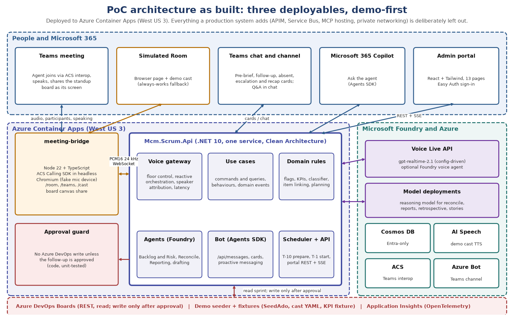
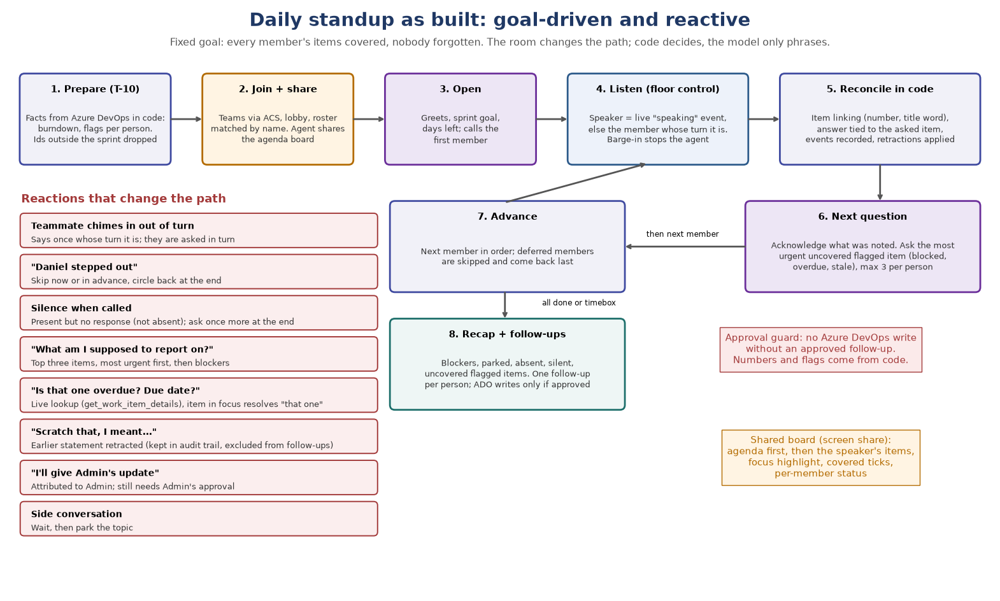

# Zava AI Scrum Master Agent: PoC Build Specification

> **Purpose:** a self-contained, demo-first build spec to hand to GitHub Copilot (coding agent, Copilot app or agent mode in VS Code) to generate a working proof of concept.
>
> **Companions:** *Zava AI Scrum Master Agent - Solution Architecture* (the why and the options) and *Zava AI Scrum Master Agent - Production Specification* (how the real system is built and run).
>
> **Owner:** James Ford (Microsoft). **Version 0.7 (M11 implementation and measured acceptance)**, November 26, 2026. **The code wins** where this document and the code disagree. `AS-BUILT.md` describes implementation; `gates/M11-gates.md` distinguishes measured acceptance from open work; `DOC-DRIFT.md` records corrections. Decision records are indexed in `adr/README.md`.

### M11 acceptance boundary

The working demo remains **Acs / Share / Direct**, with the Simulated Room
fallback. The optional hosted relay uses stable version 4; candidate 5 returned
424 during paired testing and is not promoted. The Windows native media/board
adapter is hosted but its real Teams attribution, joins and board acceptance
remain open, and it saves no meeting-derived proposals. Five delegated
Teams/Copilot skills and package 1.1.0 are implemented; live Copilot G5 is open.
Foundry IQ and Work IQ integrations are not built (G10/G11 not_run, n=0).
G7 fails revised dates (75%, n=8); latest fallback p50 regression is +6.19%
(n=10 before, n=12 after). No threshold or Domain rule was changed to pass.

**G8 recovery (ADR0031):** exact zavagf/eastus2 is admitted by native hooks,
capacity checks include restrictions/generation/available cores and both
quota rows, and the registry image-pull role is verified before deployment.
Optional approved Entra declarations survive baseline reconciliation.
Gen2 image and disposable-vault purge parameters preserve original defaults;
the selected unrestricted four-core D4als_v7 costs USD0.345/hour Windows.
First empty up/verify cycle passes1828.77s/344.83s, mandatory checks8/8,
actual approved write/auditrevision55. The127GB StandardSSD_LRS/V2 disk
and SYSTEM startup task are verified; VM/disk/IP tariffUSD0.363150685/hour
excludes variable consumption. Second empty up/verify remains pending
after intervening purge passed1639.20s with group/vault/Foundry absence
readback. The disposable parameter omits the API property,
because explicit purge-protection false was refused on new vault creation.
New zavagf catalogue upload has a measured OAuth403 human gate, not a
failed core Entra hook. Operator-completed zavaw3 retrieval/WorkIQ
consents and catalogue uploads do not prove G5/G6/G10/G11 or their fixtures.
The native opt-in is now input-only: teardown must not erase a configured
flag as a generated output. The observed reduced second iteration is not
a completed full cycle; compiled cleanup-contract regression17/17 passes.
AgentDeploy also recovers the actual Foundry409 workspace-identity change (ADR0032)
by reading the current agent before at most two creation retries, only
for that exact error. Authentication and unrelated errors are not retried.

### What changed in v0.6 (M9)

Built after the v0.5 reconciliation; the detail is in ADR 0010 and `AS-BUILT.md` section 11.

- **Ceremony kind.** `CeremonyKind` (`DailyScrum`, `SprintPlanning`, `SprintReview`, `Retrospective`) on the session aggregate (still named `StandupSession`; ADR 0009 records the naming debt). Sessions saved before this load as `DailyScrum`.
- **More change kinds.** `ChangeOp` adds `SetIteration`, `Assign` and `CreateWorkItem`. The attribution now names the approval channel and the ceremony ("Approved by {name} in {Teams|the portal}, proposed by Zava Scrum Agent from the {date} {ceremony}.").
- **Ceremony packs** (`POST /api/ceremonies/{kind}/pack`): review and retrospective packs computed in Domain code, sent to the Scrum Master as one follow-up with **Approve all** and **Reject**. **M9a:** sprint planning has its own pack with capacity, selection, a draft goal and **Approve plan** (section 10.6).
- **R1 Graph email** (`Email:Mode=Graph`), **R2 unblock loop**, **R3 commitment carry-over**, **R4 `AtRiskRule`**, **R5 recap routing** to a recap channel and the meeting chat.

### What changed in v0.4 (as built)

The PoC is built and deployed to Azure (M0 to M8, except Work IQ). This version updates the spec so it describes **what exists**, not only what was planned. Changes are marked **As built** in the sections below. The headline differences:

- **Demo scale:** three roster members (Daniel Park, Maya Lin, Admin) matching real tenant users, not five. Seed data is 29 work items (19 in the sprint, 10 in the backlog).
- **The real Teams meeting works** end to end through ACS, including agent audio (a fake microphone device is required for headless Chromium, ADR 0007) and a **screen-shared standup board**.
- **Reactive, goal-driven orchestration** (ADR 0008): the agent handles chime-ins, members stepping away (skip and circle back), silence (present but no response, different from absent), what-to-report questions, item questions, corrections that retract earlier statements, and one member giving another's update. Decisions are made by plain rules in code; the model only phrases speech.
- **Item linking is done in code**, never by a model guess, and clarifying questions are per flagged item (up to three per person).
- **Portal** moved from Fluent UI to **Tailwind CSS v4** with a sidebar layout and 13 pages.
- **M8 stretch** built: planning prep, retrospective, Story Writer, email outbox, model comparison, Foundry voice-agent mode. **Not built:** Work IQ real-time transcripts.
- Hosted in **West US 3**; Cosmos DB is live (public network, Entra-only auth) because the tenant policy blocked the private default.

### What changed in v0.3

- **Engineering standards made explicit.** The PoC stays demo-first in scope but is built to production code standards: Clean Architecture (Domain, Application, Infrastructure, Api), CQRS through a **hand-rolled mediator** with pipeline behaviours, SOLID, DRY, and full XML/TSDoc documentation. See the new section 6.1 and the rewritten `copilot-instructions.md`.
- Repository layout (section 6), stack (section 5), components (section 7), milestone M0 (section 16), tests (section 19) and success criteria (section 21) updated to match. Still three deployables.

### What changed in v0.2

v0.1 mixed PoC and production concerns. v0.2 is rewritten around one question: **can an AI agent run Zava's daily standup by voice, grounded in Azure DevOps, and close the loop with follow-ups?** Specifically:

- **Demo first.** A demo storyboard (section 2) is now the north star, and the milestones are reordered so the voice standup works by M2 instead of M3, after a demo data seeder and the pre-brief.
- **Smaller footprint.** Three deployables instead of six. The orchestrator, voice gateway, bot, scheduler and Scrum tools now run in one .NET service. API Management, Service Bus, the Functions-hosted MCP server, Foundry IQ, private networking and app roles move to the production specification.
- **Lighter governance.** Evaluation CI gates, the audit container, on-behalf-of token flows and RFC 9457 error contracts are deferred. Two guardrails stay because they are business requirements or basic hygiene: no Azure DevOps write without a person's approval, and no secrets in source control.
- **Gaps closed:**
  - a demo data seeder;
  - scripted "demo cast" participants, so one presenter can run a full standup;
  - absent and late member handling;
  - a recap posted to the meeting chat and team channel;
  - a pre-brief card for the human Scrum Master;
  - the monthly three-to-six sprint report;
  - public-store Microsoft 365 Copilot certification (the later M11 8 adds tenant packaging);
  - a requirements traceability matrix;
  - a list of what is needed from Zava before each milestone.

---

## 0. How to use this spec with GitHub Copilot

1. Create an empty repo `zava-scrum-agent` (GitHub or Azure Repos; the GitHub Copilot app works with Azure Repos in preview).
2. Commit this file as `docs/SPEC.md` and the companion `copilot-instructions.md` as `.github/copilot-instructions.md`.
3. Create one issue per milestone in section 16 (M0 to M8). Paste the milestone block into the issue and assign it to Copilot, or prompt agent mode:
   `Implement milestone M<n> from docs/SPEC.md. Follow .github/copilot-instructions.md. Stop when the milestone's demo check passes and summarise what you built and how to run it.`
4. Connect the Microsoft Learn MCP server (API shapes) and, optionally, the Azure DevOps Remote MCP Server (`https://mcp.dev.azure.com/{org}`) so Copilot can inspect the demo project while it codes.
5. Run each milestone's **demo check** yourself before starting the next. Order matters: M0 to M2 produce the core demo; everything after adds reach.

Anything marked **VERIFY** is an API detail that is new or in preview. Copilot must check current Microsoft Learn documentation before coding against it and leave a `// VERIFY: <url>` comment.

---

## 1. What the PoC must prove

| # | Hypothesis | Proven when |
|---|---|---|
| H1 | An agent can facilitate a multi-person standup by voice: calls on people by name, listens, keeps the timebox, recaps | A standup completes in 15 minutes or less without a human driving it. **As built:** three people (Daniel Park, Maya Lin, Admin); the demo cast plays up to three members and the roster matches three real tenant users |
| H2 | The agent's questions are grounded in Azure DevOps and useful | Every work item the agent mentions exists in the sprint; the human Scrum Master rates the questions useful |
| H3 | The agent captures commitments, blockers and decisions accurately enough to act on | The recap and follow-ups match what was said, as judged by the human Scrum Master in the demo |
| H4 | The loop closes after the meeting | Each person gets one Teams follow-up; an approved change appears in Azure DevOps; a rejected one never does |
| H5 | The agent can do this inside a real Teams meeting | The agent joins a Teams meeting, is heard, hears participants and completes the standup |
| H6 | The experience is responsive enough for a live conversation | Median time from end of speech to agent audio is about one second for US participants; India latency is measured |

**Current proof:** portal approval identity and approver-authored writes have
live G3 evidence; three concurrent Simulated Room sessions have historical
G9 evidence; API/bridge content-free telemetry is checked live. These do not
prove native media, live Copilot, full multi-team isolation, one-second latency,
final-solution greenfield repeatability or production scale/governance.
Private networking, resilience and cost at volume remain production scope.

---

## 2. Demo storyboard (north star)

Everything in this spec exists to make these scenes work. Build in the order of the milestones; each scene names the milestone that enables it.

| Scene | What the audience sees | Requirement | Milestone |
|---|---|---|---|
| 1. Morning prep | Ten minutes before standup, the human Scrum Master gets a Teams card: sprint goal, burndown status, and per person the stale, blocked, overdue and unassigned items with a suggested question | F2 | M1 (portal), M3 (Teams card) |
| 2. Standup opens | The agent greets the team, states the sprint goal and calls on the first person by name | F1 | M2 |
| 3. Grounded follow-up | A member says "still working on the payment retry story". The agent replies: "Story 4521 has been Active for three days. Still on track for Thursday?" | F1, F2 | M2 |
| 4. Blocker and parking lot | A member raises a blocker; two people start a side discussion; the agent says "Let's take that offline" and parks it | F1, F4 | M2 |
| 5. Absent member and timebox | The agent notes one member is absent and will follow up, warns at three minutes left, recaps blockers and parked topics, and closes | F1, F3 | M2 |
| 6. Recap and follow-ups | The recap appears in the meeting chat and team channel. Each person gets a 1:1 Teams card with their commitments and proposed Azure DevOps updates (Approve, Reject). The absent member is asked for their update | F3, F4 | M3 |
| 7. Approval writes back | The presenter approves a state change and a comment. Azure DevOps shows the change with "Approved by ..." in history | F3, N7 | M3 |
| 8. Real Teams meeting | Scenes 2 to 5 again, with the agent joined to a real Teams meeting | F1 | M4 |
| 9. Admin portal | Team, roster and schedule configuration, the live session console (mute, next speaker, end, "I'll take it from here"), the session timeline with transcript and events | F10 | M5 |
| 10. Ask the agent | Legacy reporting questions in Teams remain. M11 8 adds five delegated Teams/Copilot skills (section 12); package 1.1.0 is built, but real Copilot G5 discovery/sign-in/acceptance awaits rollout | F7 | M6; M11 8 |
| 11. Reporting | Sprint summary card in the team channel, plus a monthly report covering three to six sprints: velocity, say/do ratio, carry-over and blocker age | F7 | M6 |

**As built, scenes 2 to 6.**

- **Roster:** three members, in speaking order Daniel Park, Maya Lin and Admin (`demo/seed-ado.json`). "Admin" matches the Teams user "System Administrator". The sandbox organisation has one real user, so every seeded item is assigned to that user and tagged `demo-owner-{key}`; the roster resolves ownership from the tag (ADR 0002, `Demo:HonorOwnerTags`).
- **Scene 5 (absent member):** the shipped cast script (`demo/cast/payments-standup.yaml`) has nobody absent. In Teams, a roster member who does not join is marked absent; the cast format supports `absent: true`.
- **Scene 6 (recap and cards):** cards use `ITeamsMessenger` and the owning
  team's bound conversations (`CardRouting`, ADR 0018). No binding means
  outbox only. Card actions remain Approve/Reject; there is no Edit action.

**Fallback rule for every live demo:** if the Teams join fails, the same session runs in the Simulated Room (section 7.3) with no other change.

---

## 3. Requirements traceability

| ID | Requirement (from the November 13 meeting) | PoC coverage | Where |
|---|---|---|---|
| F1 | Join and host the daily standup by voice, calling on each person | **Full** | 7, 10, 11, M2, M4 |
| F2 | Check updates against Azure DevOps and ask follow-up questions | **Full** | 9, 10.2, M1, M2 |
| F3 | Follow up after the meeting by Teams chat or email | **Teams built** (follow-up, absent and no-response, escalation cards with Approve and Reject). **Email:** behind `Features:EmailFollowUps`; `Email:Mode=Outbox` records only, `Email:Mode=Graph` sends through Microsoft Graph (M9-R1, not verified against a live mailbox) | 10.3, 12, M3, M8 |
| F4 | Capture actions and decisions and share them | **Full** | 10.1, 12, M2, M3 |
| F5 | Prepare sprint planning and review the backlog | **Partial:** planning prep page (load per person, carry-over, Definition-of-Ready gaps, suggested owners). No voice-led planning | M8 |
| F6 | Facilitate sprint review and retrospective | **Partial:** retrospective is a text draft (start-stop-continue built in code, model-written summary), not voice-led. Sprint review not built | M8 |
| F7 | KPIs and monthly report over three to six sprints | **Full** (fixture-backed history if the demo project is new) | 10.4, M6 |
| F8 | Recommend assignments and escalate risks | Escalation follow-ups are team-routed; planning owner suggestions are written only after plan approval (M9a) | 10.3, 10.6, M3, M9a |
| F9 | Write user stories and acceptance criteria | **Draft only:** Story Writer page (model draft, or a template when no model is available); never written to Azure DevOps | M8 |
| F10 | Admin portal for teams, rosters, cadence and prompts | **Full** | 13, M5 |
| N5 | About one second voice latency | Target 1 s; **measured 3.7 s p50** in the 23 Nov Teams take (2 to 3 s was the earlier note); the M10 decision model adds latency (ADR 0014). Shown in the portal | 11.2 |
| N6 | English with Indian, Costa Rican and US accents | Tested with Zava voices if available | 11 |
| N7 | No Azure DevOps writes without approval | **Enforced in code** | 10.3 |
| N1 to N4 | Identity, monitoring, licensing, Workday | Production specification | n/a |

---

## 4. PoC architecture



Three deployables:

1. **`Zava.Scrum.Api`** (.NET 10): the orchestrator workflows, voice gateway WebSocket, Microsoft 365 Agents SDK bot endpoint, scheduler (hosted `BackgroundService`), Scrum tools (in process) and the portal API.
2. **`meeting-bridge`** (Node.js + TypeScript): the Simulated Room page and the ACS Teams interop bridge.
3. **`admin-portal`** (React static site): served by `Zava.Scrum.Api` from `wwwroot` in Azure, or by Vite locally.

External dependencies:

- Microsoft Foundry (Voice Live, model deployments);
- Azure DevOps (REST);
- Azure Communication Services (Teams interop);
- Azure Bot Service (Teams and Microsoft 365 Copilot channel);
- Azure Cosmos DB (state);
- Azure AI Speech (demo cast voices, reused from the Foundry resource);
- Application Insights.

### PoC shortcuts and their production replacements

| Concern | PoC shortcut | Production (see Production Specification) |
|---|---|---|
| Services | One .NET service plus bridge plus portal | Separate orchestrator, voice gateway and session manager scaled independently; scheduler as Container Apps jobs |
| Agent runtime | Built: API chat-client agents; optional hosted stateless voice relay with Agent ID, historical paired transport measurements. Open: candidate 5 readiness and moving orchestration/channel handlers into the host (ADRs 0021, 0022, 0028) | Hosted orchestration and production lifecycle/governance |
| Tools | In-process C# tool classes | Scrum MCP server on Azure Functions behind API Management; Foundry Toolbox with tool policies |
| Azure DevOps access | REST with Entra token (`az login` / managed identity) or a PAT in user secrets | **As built (M11 5A/8, ADRs 0020/0025):** scheduled voice reads use the managed identity; approved writes use the approver and five Copilot reads use the asker through OBO, no fallback. PROD: agent identity with least privilege (5B); Azure DevOps Remote MCP |
| Meeting bridge | Built: ACS/Simulated saved-follow-up demo. Open: native GraphMedia attribution/join/board gates despite verified Windows hosting; non-recording only | Proven native media, recording compliance where applicable and capacity |
| Messaging | In-process channels | Service Bus and Event Grid |
| Knowledge | Open: Foundry IQ unbuilt; repo working agreements are not read by code (ADR 0026) | Permission-trimmed approved knowledge sources |
| Work IQ signals | M11 8B: consent/evidence contracts and unregistered read boundary built; live spike, adapter and all four integrations blocked, G11 n=0 | Delegated owner, default-off team setting, exact channel/meeting scope, source-labelled short excerpts and human-approved proposals; no application identity or private mail/chat reads (ADR 0027) |
| Identity | Built: Entra bearer validation, app/team roles, federated OBO approval and portal audit. Open: live Teams SSO and agent policy acceptance | Reviewed least privilege, agent governance and access reviews |
| Networking | Public endpoints with Entra auth | VNet, private endpoints, Front Door WAF, egress controls |
| Quality | Built: final947.NET/25bridge checks have passing evidence after one unchanged retro retry; live content-free API/bridge workbook. Open: initial model deviation, exact board parity, failed G7 dates/latency, model CI identity and privacy-approved synthetic quality scoring | Release-qualified evaluations and online monitoring |
| History for KPIs | Azure DevOps Analytics if history exists, else a JSON fixture | Fabric OneLake plus Power BI semantic model |

---

## 5. Technology stack (pin these)

| Area | Choice |
|---|---|
| Backend | C# on **.NET 10**, ASP.NET Core minimal APIs; **Clean Architecture** (Domain, Application, Infrastructure, Api projects; one deployable) |
| CQRS / mediator | **Hand-rolled mediator** in the Application layer (section 6.1.3): `ICommand`, `IQuery`, `ISender`, `IPublisher`, pipeline behaviours. No third-party mediator package |
| Validation | FluentValidation, run by `ValidationBehavior` |
| Code quality | Central package management, `.editorconfig`, `TreatWarningsAsErrors`, XML docs required, `dotnet format`; ESLint + Prettier for TypeScript |
| Local orchestration | **Aspire 13.x** AppHost; no Makefile. `global.json` pins .NET SDK 10.0.100 |
| Agents | **As built:** `FoundryChat` runs each prompt through a Microsoft Agent Framework agent that `FoundryAgentFactory` creates with `AIProjectClient.AsAIAgent` (model `Foundry:ReasoningDeployment`, instructions from `agents/instructions`, JSON response format, `Foundry:TimeoutSeconds` timeout) with an Entra token (`DefaultAzureCredential`, no keys), behind the ports `IBacklogRiskAgent`, `IReconcileAgent`, `IReportingAgent` and `IDraftingAgent`; each returns `null` on any model failure and the caller falls back to code (ADR 0009b). `// PROD: Microsoft Agent Framework and Foundry hosted agents` |
| Voice | **Azure Voice Live API** over WebSocket `wss://<foundry-resource>.services.ai.azure.com/voice-live/realtime`, API version `2026-04-10` (**As built**; configurable). Use the .NET Voice Live client if available, else `ClientWebSocket` |
| Realtime model | Config-driven: `gpt-realtime-2.1` default (**As built**, chosen over `gpt-realtime-2.1-mini` by measurement, ADR 0019); alternatives compared on the Models page. Optional Foundry voice-agent binding via `VoiceLive:AgentName` |
| Reasoning model | A GPT mini-class deployment for reconciliation, follow-ups and summaries (config-driven) |
| Teams and Copilot | **Microsoft 365 Agents SDK** for .NET (`Microsoft.Agents.*`), Azure Bot Service (single tenant), app package built with the Microsoft 365 Agents Toolkit |
| Azure DevOps | REST API 7.x via `HttpClient` (WIQL, work items, iterations, team members, Analytics OData) |
| Meeting bridge | **Node.js 22 + strict TypeScript**, Playwright/ACS; selectable **Windows .NET Graph media host** with aligned Communications/Skype media SDK and SkiaSharp board renderer (ADRs 0023, 0024) |
| Demo cast voices | Azure AI Speech text to speech (neural voices, varied accents) |
| Admin portal | **React 19 + Vite + TypeScript + Tailwind CSS v4 + lucide-react**, MSAL.js and Container Apps Easy Auth (**As built**: Fluent UI was replaced for a modern layout) |
| State | **Azure Cosmos DB for NoSQL** in Azure (**As built**: one JSON document per collection behind `ICollectionStore`, Entra-only auth); JSON files locally |
| Hosting | **Azure Container Apps** (two apps: `api`, `bridge`; **As built**: West US 3, one `api` replica because live state is in memory) |
| Deploy | **azd** + Bicep (Azure Verified Modules where convenient) |
| Telemetry | **As built (M11 9):** content-free OpenTelemetry to Application Insights, team/session hops, bridge/host propagation, counters/histograms and shared workbook. Export uses `APPLICATIONINSIGHTS_CONNECTION_STRING` or explicit `AzureMonitor:ConnectionString` SDK configuration. Live API/bridge/model/approved-write trace is checked (211hop samples); native/hosted acceptance is not established. G7 fails dates75%n8; live Foundry quality conflicts with content capture OFF and real-model CI needs its approved OIDC configuration (ADR 0028, DEPLOY.md). |
| Tests | xUnit, hand-written port fakes and real mediator; NetArchTest.Rules 1.3.2; standup and retrospective Simulated Room E2E. Portal has no test suite |

---

## 6. Repository layout

```
zava-scrum-agent/
├─ azure.yaml                      # azd: services api, bridge
├─ infra/main.bicep                # M11: creates everything (modules/ observability, identity, foundry, data, compute) incl. the Azure Bot; infra/hooks/ holds the idempotent scripts (ADR 0015a)
├─ Directory.Build.props           # nullable, warnings as errors, analyzers, XML docs
├─ Directory.Packages.props        # central package versions
├─ .editorconfig
├─ src/
│  ├─ Zava.Scrum.AppHost/           # Aspire: runs api, bridge, portal locally
│  ├─ Zava.Scrum.Domain/            # no dependencies
│  │  ├─ Teams/ Members/ Standups/ FollowUps/ Schedules/ Planning/ Work/   # aggregates, value objects, events, rules
│  │  ├─ Flags/                    # IFlagRule + one class per rule
│  │  ├─ Kpis/                     # KpiCalculator (burndown, carry-over, blocker age)
│  │  ├─ Voice/FloorControl.cs     # pure state machine
│  │  └─ Common/                   # Entity, AggregateRoot, IDomainEvent, Result, Error
│  ├─ Zava.Scrum.Application/
│  │  ├─ Abstractions/Messaging/   # hand-rolled mediator: ICommand, IQuery, ISender, IPublisher, Mediator
│  │  ├─ Abstractions/Ports/       # IWorkItemReader/Writer, ITeamsMessenger, IVoiceSessionFactory, agents, repos, IClock
│  │  ├─ Behaviors/                # LoggingBehavior, ValidationBehavior, ExceptionMappingBehavior
│  │  ├─ Features/<Area>/<UseCase>/  # Command|Query, Handler, Validator, DTO (catalogue in 6.1.4)
│  │  ├─ Tools/ScrumTools.cs       # IScrumTools: Voice Live tools -> commands/queries
│  │  └─ DependencyInjection.cs    # AddApplication()
│  ├─ Zava.Scrum.Infrastructure/
│  │  ├─ Ado/                      # AdoRestClient, WIQL, AdoFields constants, Analytics
│  │  ├─ Agents/                   # Agent Framework agents behind ports (BacklogRisk, Reconcile, Reporting, Drafting), FoundryChat, FoundryAgentFactory, FilePromptStore
│  │  ├─ Voice/                    # VoiceLiveSessionFactory, VoiceLiveSession, model catalogue
│  │  ├─ Teams/                    # TeamsBotMessenger, OutboxTeamsMessenger, CardRenderer, HttpMeetingBridge, OutboxEmailSender
│  │  ├─ Persistence/              # JsonFile* repositories over ICollectionStore (FileCollectionStore, CosmosCollectionStore)
│  │  └─ DependencyInjection.cs    # AddInfrastructure()
│  ├─ Zava.Scrum.Api/
│  │  ├─ Endpoints/                # <Feature>Endpoints.cs, ResultExtensions.ToHttpResult()
│  │  ├─ Bot/                      # Agents SDK activity handler (adapter only)
│  │  ├─ Voice/                    # VoiceGateway loop, BridgeConnection, token service, live registry
│  │  ├─ Scheduling/               # ScheduleWorker BackgroundService
│  │  └─ Program.cs                # composition root
│  ├─ tests/
│  │  ├─ Zava.Scrum.Domain.Tests/
│  │  ├─ Zava.Scrum.Application.Tests/      # handlers with fakes in TestDoubles/, mediator tests
│  │  ├─ Zava.Scrum.Infrastructure.Tests/   # session repository contract (JSON file only), ADO mapping, agents, card rendering
│  │  └─ Zava.Scrum.ArchitectureTests/
│  ├─ meeting-bridge/               # Node/TS: src/domain, src/services, src/routes (/room, ACS bridge, cast player)
│  └─ admin-portal/                # React + Tailwind CSS v4: src/features/*, src/ui, src/api (typed client), src/hooks
├─ agents/instructions/*.md        # facilitator, backlog-risk, reconcile, reporting, retrospective, story-writer and turn-* prompts
├─ knowledge/working-agreements.md # present, but not read by any code (see 10)
├─ demo/
│  ├─ seed-ado.json                # demo backlog definition
│  ├─ cast/*.yaml                  # scripted participants for the Simulated Room
│  └─ kpi-history.json             # fixture for 6 past sprints if the ADO project has no history
├─ tools/SeedAdo/                  # console app: creates the demo team, sprint and work items
├─ appPackage/                     # Teams bot app manifest, icons and the sideload zip
├─ docs/SPEC.md, AS-BUILT.md, CEREMONIES.md, DEMO.md, DOC-DRIFT.md, docs/adr/
└─ .github/copilot-instructions.md
```

**Multi-team (M11, ADR 0018).** Team model and pure rules live in `Domain/Teams` (`TeamAccess`, `WorkItemScope`, `AdoOrganisation`, `TeamsBinding`) and `Domain/Capacity` (`CapacityGovernor`); use cases in `Application/Features/Teams`; `Infrastructure/Ado` holds the per-organisation client factory; `Api/Auth` holds the team filter; `Api/Seeding` the demo team seeder.

**Additional M11 hosts/tools:** `src/Zava.Scrum.AgentHost` is the optional
stateless hosted voice relay; `src/Zava.Scrum.MediaBot` is the Windows native
media alternative. Both have dedicated test projects. `tools/GateRunner`,
`tools/VoiceRelayBench`, `tools/DecisionEval` and `tools/AgentDeploy` provide
measurement/deployment tooling, not additional portal services. The portal
remains served by the API; orchestration and channel handlers remain there.

### 6.1 Architecture and coding standards

The PoC is demo-first in **scope**, not in **code quality**. It is built to the same engineering standards as the production system so that the code that wins the demo can be carried forward. `.github/copilot-instructions.md` holds the full rule set; this section is the design it applies to.

#### 6.1.1 Clean Architecture layers

| Project | Holds | May reference | Must not reference |
|---|---|---|---|
| `Zava.Scrum.Domain` | Aggregates (`Team`, `Member`, `StandupSession`, `FollowUp`, `Schedule`), value objects (`WorkItemId`, `SprintRef`, `Flag`), domain events, pure rules: `IFlagRule` implementations, `KpiCalculator`, `FloorControl` state machine, approval invariants | nothing (BCL only) | any other project; ASP.NET, Azure, HTTP, JSON, MAF, Voice Live, ADO packages |
| `Zava.Scrum.Application` | Commands, queries, handlers, validators, DTOs; ports (`IWorkItemReader`, `IWorkItemWriter`, `ITeamsMessenger`, `IVoiceSessionFactory`, `IBacklogRiskAgent`, `IReconcileAgent`, `IReportingAgent`, `IDraftingAgent`, `IPromptStore`, `IEmailSender`, `IModelCatalog`, repositories, `IClock`); `IScrumTools`; the hand-rolled mediator and pipeline behaviours; `Result`/`Error` | Domain, FluentValidation, `Microsoft.Extensions.*.Abstractions` | Infrastructure, Api, any SDK |
| `Zava.Scrum.Infrastructure` | Adapters implementing the ports: `AdoRestClient`, `AdoWorkItemWriter`, the `JsonFile*` repositories over `ICollectionStore` (`FileCollectionStore` or `CosmosCollectionStore`), `VoiceLiveSessionFactory`, Foundry chat agents, `TeamsBotMessenger` and `OutboxTeamsMessenger`, `FilePromptStore`, `SystemClock`; `AddInfrastructure()` | Application, Domain, Azure/MAF/Agents SDK packages | Api |
| `Zava.Scrum.Api` | Composition root; minimal API endpoints per feature; bot activity handler; bridge WebSocket endpoint and voice gateway loop; scheduler `BackgroundService`; SSE; `ToHttpResult()` mapping | all of the above | (business logic of any kind) |

Presentation adapters (endpoints, bot handler, WebSocket loop, scheduler, Voice Live tool dispatch) translate input into a command or query, call `ISender`, and translate the `Result` back. The audio hot path (forwarding PCM frames between the bridge and Voice Live) is the one deliberate exception: it bypasses the mediator for latency, but every *decision* it needs (floor control, tool calls) goes through Domain or a query.

#### 6.1.2 Request flow

```
Teams card / portal / scheduler / Voice Live tool call
      │  (Api adapter: map input -> command or query)
      ▼
ISender.Send(request)
      │  LoggingBehavior -> ValidationBehavior -> ExceptionMappingBehavior
      ▼
Handler (Application)  ── uses ports ──►  Infrastructure adapters (ADO, Cosmos/JSON, Foundry chat, Agents SDK)
      │  loads aggregate, calls Domain behaviour, saves
      ▼
Domain events (e.g. FollowUpApproved)  ──►  IPublisher  ──►  INotificationHandler(s)
      │
      ▼
Result<T>  ──►  adapter maps to HTTP / card update / tool result / spoken response
```

#### 6.1.3 Hand-rolled mediator (contract)

The mediator is a small piece of our own code in `Zava.Scrum.Application/Abstractions/Messaging`. No third-party mediator package is used. Target size: under ~200 lines plus tests.

```csharp
/// <summary>Marker for a request that changes state. Returns a <see cref="Result"/>.</summary>
public interface ICommand : IRequest<Result>;
/// <summary>Marker for a request that changes state and returns a value (usually an id).</summary>
public interface ICommand<TResponse> : IRequest<Result<TResponse>>;
/// <summary>Marker for a side-effect-free read.</summary>
public interface IQuery<TResponse> : IRequest<Result<TResponse>>;
public interface IRequest<TResponse>;

public interface IRequestHandler<in TRequest, TResponse> where TRequest : IRequest<TResponse>
{
    Task<TResponse> Handle(TRequest request, CancellationToken ct);
}

/// <summary>Cross-cutting step wrapped around every request, in registration order.</summary>
public interface IPipelineBehavior<in TRequest, TResponse> where TRequest : IRequest<TResponse>
{
    Task<TResponse> Handle(TRequest request, Func<Task<TResponse>> next, CancellationToken ct);
}

public interface IDomainEvent { DateTimeOffset OccurredAt { get; } }
public interface INotificationHandler<in TEvent> where TEvent : IDomainEvent
{
    Task Handle(TEvent domainEvent, CancellationToken ct);
}

public interface ISender    { Task<TResponse> Send<TResponse>(IRequest<TResponse> request, CancellationToken ct = default); }
public interface IPublisher { Task Publish(IDomainEvent domainEvent, CancellationToken ct = default); }
```

Implementation rules:

- `Mediator : ISender, IPublisher` resolves `IRequestHandler<TRequest,TResponse>` and the `IPipelineBehavior<,>` chain from DI and composes them. Build the closed generic wrapper per request type once and cache it in a `ConcurrentDictionary<Type, …>`; no reflection per call after the first.
- `AddApplication()` scans the Application assembly once at startup and registers handlers (scoped), validators and notification handlers. Behaviours are registered explicitly, in order: `LoggingBehavior`, `ValidationBehavior`, `ExceptionMappingBehavior`.
- Exactly one handler per request (startup fails fast otherwise); zero or more handlers per domain event, run sequentially, each idempotent. A failing notification handler is logged and does not roll back the command (`// PROD:` outbox).
- Aggregates collect events in `DomainEvents`; repositories' `SaveAsync` is followed by `IPublisher.Publish` for each event (done in a small `DomainEventDispatcher` the handlers call, or in the repository decorator; pick one and record it in an ADR).
- Unit tests cover: dispatch to the right handler, behaviour order, validation short-circuit, exception mapping, notification fan-out, and the missing/duplicate handler startup check.

#### 6.1.4 Use-case catalogue

Workflow names used elsewhere in this spec (for example `PrepareStandup`, `ApplyApprovedChanges`) are the commands below. **This table was reconciled with the code on 22 November 2026**; `DOC-DRIFT.md` lists each use case with its file, endpoint and test.

| Area | Commands (change state) | Queries (read only) | Domain events -> handlers |
|---|---|---|---|
| Teams | `UpdateTeamSettingsCommand`, `SyncRosterCommand`, `SetRecapChannelCommand` (M9-R5), `UpdateMemberAvailabilityCommand` (M9a); **M11 (ADR 0018)** `CreateTeamCommand`, `UpdateTeamCommand`, `ArchiveTeamCommand`, `BindTeamsConversationCommand`, `SetMembershipCommand`, `RemoveMembershipCommand`, `SyncMembershipsFromGroupCommand` | `GetTeamQuery`, `GetRosterQuery`, `ListCardsQuery`; **M11** `ListTeamsQuery`, `TestTeamConnectionQuery`, `GetFleetQuery`, `ListAdoProjectsQuery`, `ListAdoTeamsQuery`, `ListMembershipsQuery` | |
| Sprint calendar (M9d) | `ProposeSprintCalendarCommand`, `ApproveSprintCalendarCommand`, `RejectSprintCalendarCommand` | `GetSprintCalendarQuery`, `ListSprintCalendarsQuery` | `SprintCalendarProposed` -> `SendCalendarCardOnSprintCalendarProposed` |
| Schedules and prompts | `UpdateScheduleCommand`, `UpdatePromptCommand`, `RunScheduleTickCommand` | `GetScheduleQuery`, `GetPromptQuery`, `ListPromptsQuery` | |
| Voice | `AnalyseUtteranceQuery` (intent, items and comment kinds for one utterance; model first, rules as fallback) |
| Standups | `PrepareStandupCommand` (creates session and pre-brief), `StartStandupCommand`, `JoinMeetingCommand`, `ControlStandupCommand`, `RecordStandupEventCommand`, `RetractStandupEventCommand`, `MarkAbsentCommand`, `ResolveUnblockerCommand` (M9-R2), `ParkTopicCommand`, `CompleteSpeakerTurnCommand`, `RecordAgentLatencyCommand`, `EndStandupCommand` | `GetNextSpeakerQuery`, `GetMemberBriefQuery`, `ReconcileUpdateQuery`, `GetWorkItemDetailsQuery`, `GetTimeRemainingQuery`, `GetTurnInstructionQuery`, `GetFacilitatorInstructionsQuery`, `GetLiveStateQuery`, `ListSessionsQuery`, `GetSessionQuery` (includes the pre-brief), `GetSessionEventsQuery` | `StandupPrepared` -> `SendPreBriefCardOnStandupPrepared`; `StandupEnded` -> `PostRecapOnStandupEnded` (routed to the recap channel and meeting chat), `SendFollowUpsOnStandupEnded` (sends `SendFollowUpsCommand`), `LeaveMeetingOnStandupEnded` |
| Follow-ups | `ProposeAdoChangeCommand`, `SendFollowUpsCommand` (also plans escalation, absent and no-response follow-ups), `ApproveFollowUpCommand` (carries a `DecisionContext`: the verified `ActorIdentity`, channel, authentication claims and roles; refused unless `ApprovalAuthority` allows it, and it appends an `ApprovalRecord`), `RejectFollowUpCommand`, `ApplyApprovedChangesCommand` | `ListFollowUpsQuery`, `GetFollowUpQuery`, `ListEmailsQuery` | `FollowUpApproved` -> `ApplyOnFollowUpApproved` (sends `ApplyApprovedChangesCommand`), `UpdateFollowUpCardHandler`; `FollowUpRejected`, `FollowUpApplied` -> `UpdateFollowUpCardHandler` |
| Reports and Q&A | | `GetKpisQuery`, `GetSprintReportQuery`, `GetMonthlyReportQuery`, `AnswerTeamQuestionQuery` (legacy Teams chat Q&A), `AnswerCopilotQuestionQuery(asker, skill, chosenTeamId)` (five delegated read-only skills, M11 8) | |
| Ceremonies (M9) | `CreateCeremonyPackCommand` (builds the review or retrospective pack and sends it as a Scrum Master follow-up) | | |
| Sprint planning (M9a) | `PreparePlanningCommand`, `ApprovePlanCommand`, `RejectPlanCommand` | `GetPlanningPackQuery` | `PlanningPrepared` -> `SendPlanningCardOnPlanningPrepared` |
| Audit (M11) | none (the approval trail is appended by `ApproveFollowUpCommand`, `RejectFollowUpCommand` and `ApplyApprovedChangesHandler`) | `GetAuditChainQuery` | none |
| Retrospective by voice (M9b) | `PrepareRetrospectiveCommand`, `NameRetroThemesCommand`, `CreateRetroOutcomeCommand` | `ReconcileRetroUpdateQuery`, `GetRetroBoardQuery` | `RetrospectiveEnded` -> `FinishOnRetrospectiveEnded` (leaves the meeting, sends `CreateRetroOutcomeCommand`) |
| Planning and stretch | | `GetPlanningPrepQuery`, `GetRetrospectiveQuery`, `DraftUserStoryQuery`, `ListParkedTopicsQuery`, `GetModelComparisonQuery` | |
| Demo and health | `ResetDemoCommand` | `GetDemoStatusQuery`, `GetHealthQuery` | |

**Planned but not built, and why:** `GetPreBriefQuery` (the pre-brief is returned inside `GetSessionQuery`); `EscalateBlockerCommand` and the `BlockerEscalated` event with `NotifyScrumMasterHandler` (escalation is a follow-up kind planned by `FollowUpPlanner`, ADR 0004).

**Tools.** The Voice Live tools (section 7.2) call these use cases through `ISender`: `get_next_speaker` -> `GetNextSpeakerQuery`, `get_member_brief` -> `GetMemberBriefQuery`, `reconcile_update` -> `ReconcileUpdateQuery`, `record_event` -> `RecordStandupEventCommand`, `park_topic` -> `ParkTopicCommand`, `mark_absent` -> `MarkAbsentCommand`, `get_time_remaining` -> `GetTimeRemainingQuery`, `end_standup` -> `EndStandupCommand`, `get_work_item_details` -> `GetWorkItemDetailsQuery`.

**M11 6a:** no Application use case or port is added. The native media presentation routes reuse `GetSessionQuery`, `GetRosterQuery` and the normal `EndStandupCommand`; `GraphMediaBridge` implements the existing `IMeetingBridge`. The ephemeral audio path intentionally bypasses commands and has no writable tool surface (ADR 0023).

**M11 7 (ADR 0024):** `ReceiveMeetingEventCommand` is the Teams use case for
authenticated scheduled meeting start/end metadata. It resolves tenant and bound
conversation, matches the stored meeting, records metadata and publishes the
existing ceremony end events exactly once. No new portal endpoint or voice tool.
Native board snapshots reuse Domain `ItemMentions`, `RetroInterpreter`,
`RetroAgenda` and `RetroSummary` without persistence or model-computed numbers.

**M11 8B (ADR 0027):** typed `IWorkSignals`, consent/scope/retention ports,
Domain consent/access rules and the unregistered `WorkSignalReader` are
contract-stage code only. No new production command/query/event is registered;
the real-mediator test entry is test-only. Enable/connect/revoke, persistence
commands and integration queries must be catalogued when the live spike
supports their implementation, not presented as shipped use cases now.

#### 6.1.5 Code standards summary

| Standard | How it shows up in this repo | Checked by |
|---|---|---|
| Clean Architecture | Four projects, dependency rule in 6.1.1 | `Zava.Scrum.ArchitectureTests` (NetArchTest.Rules) |
| CQRS + mediator | One folder per use case; commands return `Result`, queries return DTOs; behaviours for logging, validation and errors | Architecture tests (naming, handler visibility, no handler-to-handler calls), mediator unit tests |
| SOLID | Role-specific ports, `IFlagRule` strategies, behaviour methods on aggregates, constructor injection only | Code review, architecture tests (Domain has no outward references) |
| DRY | Single sources for config keys, prompts, ADO field names, card templates, error codes, bridge message types; extract on the third repeat | Code review. There is no bridge-protocol sync test (the protocol is mirrored in `protocol.ts` and `VoiceGateway.cs`) |
| Well documented | XML docs on all Domain and Application members and public Infrastructure/Api types; TSDoc on exported TypeScript; ADRs for deviations | `GenerateDocumentationFile` + `TreatWarningsAsErrors` (CS1591). TSDoc is by convention: ESLint runs `typescript-eslint` strict without `jsdoc` rules. Each project has a short `README.md` except `Zava.Scrum.AppHost` and `src/tests` |
| Well organised | Folder = namespace, one type per file, feature folders, central package management, `.editorconfig` | `dotnet format --verify-no-changes`, ESLint + Prettier |
| Well commented | Comments explain why, cite SPEC section or requirement id; `// PROD:`, `// VERIFY:`, `// DEMO:` markers; no bare TODOs or commented-out code | ESLint `no-warning-comments` bans `TODO` and `FIXME` in TypeScript; C# relies on code review |


#### 6.1.6 Domain rules added during the build

Pure Domain rules added during the build (all unit tested in `Zava.Scrum.Domain.Tests` except where noted); the matching use cases are in 6.1.4 (see ADRs 0004 to 0008):

- `ItemMentions` (links speech to work items), `UtteranceClassifier` and `ItemQuestionDetector` (what an utterance is trying to do), `CoverageNotes` and `ReportingPriorities` (what to say about uncovered items), `FallbackQuestions`.
- Deferral, circle-back and retraction in `StandupSession`; `DeferCurrent`, `DeferSpeaker` and `Deferring` in `FloorControl`.
- `RetrospectiveBuilder`, `PlanningPlanner`, `ModelCostEstimator`, `KpiCalculator`, `BurndownCalculator`, `ScheduleEvaluator`, `FollowUpPlanner`.

---

## 7. Components

### 7.1 `Zava.Scrum.Api`
- **Use cases** are commands and queries dispatched through the hand-rolled mediator (section 6.1). The former workflow names map to them: `PrepareStandupCommand`, `StartStandupCommand`/`EndStandupCommand`, `SendFollowUpsCommand`, `ApplyApprovedChangesCommand`, `GetSprintReportQuery`, `GetMonthlyReportQuery`. The handler stays the unit of work. `// PROD: multi-step agent reasoning may use a Microsoft Agent Framework workflow behind a port.`
- The bullets below are **Api-layer adapters**: they map input to a command or query and contain no business logic.
- **Voice gateway:** WebSocket `/ws/bridge/{sessionId}` (protocol in section 8), one Voice Live session per standup, floor control (section 11.3), tool dispatch to in-process tools.
- **Bot:** `/api/messages` for Teams and Microsoft 365 Copilot (section 12).
- **Scheduler:** a `BackgroundService` that checks schedules every 30 seconds. (**As built**: it ticks every 15 seconds.) At T-10 minutes it runs `PrepareStandup` and sends the pre-brief card to the human Scrum Master. At T-1 minute it starts the session with the configured bridge.
- **Portal API:** section 14.

### 7.2 Scrum tools (in process)
**As built:** `ScrumTools` defines nine tools: `get_next_speaker`, `get_member_brief`, `reconcile_update`, `record_event`, `park_topic`, `mark_absent`, `get_time_remaining`, `end_standup` and `get_work_item_details` (live state, owner, due date, overdue and points for one sprint item; used to answer teammates' questions). `propose_ado_change`, `escalate_blocker` and `get_kpis` were planned and are **not built** as tools (the use cases exist as `ProposeAdoChangeCommand`, `SendFollowUpsCommand` and `GetKpisQuery`, reachable by endpoint). The facilitator model is offered only the read-only tools (`get_member_brief`, `get_time_remaining`, `get_work_item_details`); the gateway records events, parks topics and ends the standup itself. Implement them in the Application layer behind an `IScrumTools` interface; each tool sends the matching command or query (section 6.1.4) through `ISender` and holds no logic of its own. This keeps the tools exposable as an MCP server later without changing callers.

### 7.3 `meeting-bridge`
Implements one protocol (section 8) in three modes:
- **`simulated`** (build first): `/room/{sessionId}` is a browser page. It shows the roster with avatars, the current speaker, live captions, a timebox bar and the parking lot. The presenter picks "who am I" and talks with push-to-talk or open mic. It needs no ACS and runs locally.
- **Demo cast** (part of `simulated`): `demo/cast/*.yaml` scripts the other participants. When the agent calls on a cast member, the bridge synthesises their line with Azure AI Speech and streams it as that participant. One presenter can then demo a standup (**As built**: three people). Script lines can branch on keywords in the agent's question, and a line marked `otherwise: true` answers any question no keyword matched (once), because the agent words its questions freely (22 Nov 2026: the keyword-only cast left Daniel and Admin silent after the agent rephrased its questions).

```yaml
# demo/cast/payments-standup.yaml
members:
  - memberId: m-011
    voice: en-IN-NeerjaNeural
    turns:
      - say: "Yesterday I finished the refund API tests. Today I'm picking up the retry story. No blockers."
      - when: ["on track", "Thursday"]
        say: "It slipped because the sandbox was down. I should finish tomorrow."
  - memberId: m-012
    voice: en-US-AndrewNeural
    absent: true
  - memberId: m-013
    voice: es-CR-MariaNeural    # English lines, Costa Rican accent profile
    turns:
      - say: "I'm blocked on bug 4602. I need database access from the platform team."
```

- **`acs`**: Playwright launches headless Chromium on an internal page using the ACS Calling Web SDK. The page joins the Teams meeting by `joinUrl` as "Zava Scrum Agent", captures incoming meeting audio and dominant-speaker events, and plays agent audio as its microphone stream (**VERIFY** the raw-audio APIs in the sample). It reports participants and lobby state. **As built:** the page also (a) shares a canvas-drawn standup board as the agent's screen (`call.startScreenSharing`, supervised and retried, status shown as Bridge events), (b) reports each participant's live speaking state so the gateway can attribute mixed audio to a member, and (c) matches Teams names to the roster by any word of the name ("System Administrator" matches "Admin"). Chromium is launched with `--use-fake-device-for-media-stream`, without which the ACS SDK ignores custom audio when no microphone exists.

### 7.4 `admin-portal`
Section 13.

---

## 8. Bridge protocol (bridge <-> Voice gateway)

WebSocket `wss://{api}/ws/bridge/{sessionId}?mode=acs|simulated`, authenticated with a short-lived session token returned by `POST /api/sessions/{id}/start`.

- **Binary frames:** PCM16 little-endian, 24 kHz, mono, 20 ms frames (960 bytes). Inbound is meeting audio; outbound is agent audio.
- **Text frames (JSON):**

```jsonc
{ "type": "hello", "sessionId": "...", "mode": "acs", "version": 1 }
{ "type": "participants", "items": [ { "participantId": "...", "displayName": "Priya S.", "aadObjectId": "<guid>|null" } ] }
{ "type": "dominantSpeaker", "participantId": "...", "ts": "..." }
{ "type": "localSpeaker", "memberId": "m-014" }                  // simulated room / demo cast
{ "type": "lobby", "state": "waiting|admitted|denied" }
{ "type": "agentAudioState", "state": "speaking|idle" }
{ "type": "caption", "role": "agent|participant", "memberId": "m-014|null", "text": "..." }
{ "type": "ui", "state": { "currentSpeaker": "m-014", "remainingSec": 420, "parkingLot": ["..."] } }  // gateway -> simulated room
{ "type": "control", "action": "flush|mute|unmute|leave" }       // gateway -> bridge
{ "type": "board", "speaker": "Maya Lin|null", "focus": 14, "items": [ { "id": 14, "title": "...", "flags": ["Overdue"], "covered": false, "owner": "..." } ], "team": [ { "name": "...", "total": 5, "covered": 2, "status": "away|no response|null" } ], "ended": false }  // gateway -> bridge (As built: drives the shared screen)
{ "type": "speaking", "memberId": "m-maya", "active": true }       // bridge -> gateway (As built)
{ "type": "callState", "state": "Joining|Lobby|Connected|Live|Ended|Info", "message": "..." }  // bridge -> gateway (As built: recorded as Bridge events)
{ "type": "command", "action": "begin|takeover|release|mute|unmute|skip|end" }  // As built
{ "type": "error", "code": "LOBBY_TIMEOUT|JOIN_FAILED|MEDIA_FAILED", "message": "..." }
```

**Speaker attribution:**

1. Match `aadObjectId` to `members.aadObjectId`.
2. Otherwise, fuzzy-match the display name.
3. In the Simulated Room, use `localSpeaker`.
4. **As built:** in Teams, the member whose live `speaking` event overlaps the speech is the speaker; otherwise the person whose turn it is. A member speaking for a teammate is attributed to that teammate (and recorded as such).
5. In a standup, the person called on is the default attribution for speech during their turn. If someone else speaks for longer than three seconds, the agent confirms who it was.

---

## 9. Azure DevOps integration

### 9.1 Access
- Preferred: an Entra token for resource `499b84ac-1321-427f-aa17-267ca6975798/.default` via `DefaultAzureCredential`. Locally that is the developer's `az login`; in Azure it is the app's managed identity, which must be added to the Azure DevOps organisation.
- Fallback when the org is not Entra-backed or the identity cannot be added in time: a PAT (Work Items Read & Write, Analytics Read) in .NET user secrets locally or a Container Apps secret in Azure. Behind `Ado:AuthMode = Entra | Pat`.

### 9.2 Demo data seeder (`tools/SeedAdo`)
Creates, idempotently, in a sandbox project:

- a team "Payments (Demo)" with an area path;
- the current two-week iteration with a sprint goal in the iteration description;
- 29 work items from `demo/seed-ado.json`, designed to trigger every flag: 19 in the current sprint, and 10 backlog items (6 ready, 2 without acceptance criteria, 1 unestimated, 1 of 13 points; 3 unassigned) plus the next iteration "Sprint 43" for sprint planning (M9a). Re-running `SeedAdo` resets every item, including ones a plan moved.

The flag-triggering items are:

- two stories Active with `StateChangeDate` more than two days ago. Either seed two or more days before the demo, or add a tag such as `demo-age-3` that the flag rules treat as three extra days in state when `Demo:HonorAgeTags=true`;
- one bug tagged `Blocked`;
- one task past its `TargetDate`;
- two unassigned items;
- healthy items for contrast.

**As built:** the sandbox organisation has one real user, so each item is assigned to the signed-in user and tagged `demo-owner-{key}` (`daniel`, `maya`, `admin`); the roster comes from `demo/seed-ado.json` and ownership resolves from the tag when `Demo:HonorOwnerTags` is true (ADR 0002). `demo-age-N` and `demo-quiet-N` tags shift `StateChangeDate` and `ChangedDate` back when `Demo:HonorAgeTags` is true. `// PROD: AssignedTo and the Azure DevOps team roster only.`

### 9.3 Reads
WIQL (parameterise project, team and area; map field names through `teams.ado.fieldMap` so Agile, Scrum, CMMI and custom templates work):

```sql
SELECT [System.Id],[System.Title],[System.WorkItemType],[System.State],[System.AssignedTo],
       [Microsoft.VSTS.Common.StateChangeDate],[System.ChangedDate],[Microsoft.VSTS.Scheduling.StoryPoints],
       [Microsoft.VSTS.Scheduling.RemainingWork],[Microsoft.VSTS.Scheduling.TargetDate],[System.Tags]
FROM WorkItems
WHERE [System.TeamProject] = @project
  AND [System.IterationPath] = @CurrentIteration('[{project}]\{team}')
  AND [System.WorkItemType] IN ('User Story','Product Backlog Item','Bug','Task')
  AND [System.State] NOT IN ('Closed','Removed','Done')
```

**Flag rules (pure C#, unit tested):**

| Flag | Rule |
|---|---|
| `stale` | In progress and `StateChangeDate < today - staleDays` |
| `blocked` | Tag `Blocked`, or `Blocked = Yes` |
| `overdue` | `TargetDate < today` |
| `unassigned` | No assignee |
| `no_recent_update` | In progress and `ChangedDate < today - 1` |
| `at_risk` (M9-R4, `AtRiskRule`) | Not done, due (`FinishDate` or `TargetDate`) from now to `Flags:AtRiskDays` ahead (default 2), and either `RemainingWork / OriginalEstimate` is above `Flags:AtRiskRemainingPct` (default 0.5) or the item is still `New`. Items already past due are `overdue`, not at risk. Ranked between `overdue` and `stale` in `ReportingPriorities` |
| `missed_commitment` (M9-R3) | A commitment recorded two or more standups ago whose item is still open |
| `burndown_risk` | Remaining points divided by days left is greater than 1.3 times the average daily completion so far |

### 9.4 Writes (only after approval)
`ChangeOp` has six operations and `AdoWorkItemWriter` implements all six:

| Op | Value | Written as |
|---|---|---|
| `Comment` | Comment text | `System.History` |
| `State` | New state | `System.State` plus a comment |
| `Tag` | `+Name` or `-Name` | Merged into `System.Tags` plus a comment |
| `SetIteration` (M9) | Iteration path | `System.IterationPath` plus a comment |
| `Assign` (M9) | Display or unique name | `System.AssignedTo` plus a comment |
| `CreateWorkItem` (M9) | Title; the item is in `ProposedChange.New` (type, description, tags, iteration path, assignee) | `POST {project}/_apis/wit/workitems/${type}` where the project is the first segment of the iteration path; the attribution is the new item's first comment (`System.History`) |

**As built:** the daily standup's `FollowUpPlanner` proposes **comments only**. `SetIteration` and `Assign` are proposed by the sprint plan (section 10.6) and `CreateWorkItem` by the retrospective pack (section 10.5). State and Tag changes can be proposed only through `POST /api/followups/propose`, which the portal does not call.

Each write adds the attribution "Approved by {name} in {Teams|the portal}, proposed by Zava Scrum Agent from the {date} {ceremony}." (`ApprovedChange.Attribution`). The channel is the card action (Teams) or the portal endpoint (`ApproveFollowUpCommand.Channel`); the ceremony is the follow-up's `Ceremony` ("standup" for the daily scrum, so the standup text is unchanged). A write needs an approved follow-up: `FollowUp.GetApprovedChanges` returns an error unless the status is `Approved`, `AdoWorkItemWriter` accepts only an `ApprovedChange`, and `ApprovalGuardKindsTests` and `ApplyApprovedChangesTests` cover the refusal for every kind. This check lives in code, not in a prompt.

### 9.5 KPI history
`get_kpis(teamId, sprints)` reads iteration history from Azure DevOps Analytics OData (`WorkItemSnapshot` / `Iterations`) when at least three past sprints exist. Otherwise it reads `demo/kpi-history.json`, and the portal labels the data "illustrative".

---

## 10. Agents

The prompts live in `agents/instructions/*.md` and are rendered with team values (`PromptTemplate`). **As built:** `knowledge/working-agreements.md` exists but no code appends it to the prompts, and `{humanSmName}` is not a placeholder any template uses.

### 10.1 Facilitator (Voice Live, model-direct)
Tools: those in section 7.2 that a facilitator needs. Starter `facilitator.md`:

```
You are the Zava Scrum Agent, a friendly, concise junior Scrum Master running the daily standup for team {teamName}.
A human Scrum Master ({humanSmName}) is present. If they speak to you or redirect, defer to them immediately.
Flow:
1. Open in one or two sentences: greet the team and state the sprint goal "{sprintGoal}" and days left ({daysLeft}).
2. Call get_next_speaker and invite that person by first name. Cover: what they finished, what is next, any blockers.
3. Listen. Speak only when the system gives you the floor.
4. After each person call reconcile_update. If it returns a suggestedQuestion, ask it (at most one question per person),
   naming the work item number and a short title. Never invent work item numbers.
5. Record commitments, blockers and decisions with record_event.
6. If two or more people discuss one topic for more than about 60 seconds, say "Let's take that offline" and call park_topic.
7. If get_next_speaker returns an absent member, say "{name} isn't here today, I'll follow up with them" and call mark_absent.
8. When told time is nearly up, say there are about three minutes left and speed up.
9. Close with a recap of no more than three sentences: blockers, parked topics, and that follow-ups are coming in Teams.
Never change estimates, assignments or states yourself; offer to propose an update for the person to confirm.
Speak in short sentences. Do not read lists aloud. Warm, professional tone.
```

### 10.2 Backlog & Risk (Foundry chat agent behind `IBacklogRiskAgent`, read only)
- `PrepareStandup` builds the `PreBrief` in code (WIQL plus flag rules). The agent only writes the `suggestedQuestion` per member and a two-sentence team summary.
- `reconcile_update(memberId, utterance)` sends the member's brief and the transcribed update to the reasoning model with structured output:

```jsonc
{ "consistent": true, "mentionedWorkItemIds": [4521], "risks": ["4521 stale 3 days"],
  "suggestedQuestion": "Story 4521 has been Active for three days. Still on track for Thursday?",
  "events": [ { "type": "commitment", "text": "Finish retry story tomorrow", "workItemIds": [4521] } ],
  "retracts": [] }
```

- Any `workItemId` not in the member's brief or the sprint is dropped in code before it is returned. **As built:** item links and the next question are decided in code (`ItemMentions`, `FallbackQuestions`); the model supplies events and the retraction of corrected statements (`retracts`, ADR 0008). The reconcile for the **current** speaker is pre-computed on each transcript segment while they are still talking, and reused if the text has not changed. There are no `proposedAdoChanges` in the reply.

**`PreBrief` contract:**

```jsonc
{ "teamId": "...", "iterationPath": "...", "sprintGoal": "...", "daysLeft": 6,
  "burndown": { "committedPoints": 40, "completedPoints": 14, "remainingPoints": 26, "atRisk": true },
  "members": [ { "memberId": "m-011", "items": [ { "id": 4521, "title": "Payment retry", "type": "User Story",
      "state": "Active", "daysInState": 3, "flags": ["stale"] } ], "suggestedQuestion": "..." } ],
  "teamRisks": ["2 items unassigned", "Bug 4602 blocked for 4 days"], "summary": "..." }
```

### 10.3 Follow-up (pure code: `FollowUpPlanner`)
- Input: session events and the pre-brief. Output: `followups` documents. **As built:** there is no model in this step; `FollowUpPlanner` (Domain) plans them.
- Per person, send at most one message containing:
  - their commitments;
  - open questions;
  - proposed Azure DevOps changes, with Approve and Reject buttons (no Edit action; one approval covers the member's comments).
- **Unblock loop (M9-R2).** When a blocker is recorded, the next turn asks "Who can help unblock this?" (`agents/instructions/turn-unblocker.md`, `SpeakReason.Unblocker`). `UnblockerResolver` (Domain) matches the answer to exactly one other roster member; `ResolveUnblockerCommand` stores `UnblockerMemberId` on the blocker event. `FollowUpPlanner` then adds an `Unblock` follow-up for that member (card without actions, plus email) with the item, who is blocked and what was said. The next pre-brief lists still-blocked items with their unblocker (`MemberBrief.HelpRequests`, `TeamRisks`) and the agent asks the unblocker in their turn.
- Absent members get "We missed you at standup. Reply with your update or approve these suggested changes."
- **Escalation:** a blocked item that has been blocked for at least `Flags:EscalateBlockerAfterDays` triggers an escalation follow-up **whether or not it was raised again** (M9-R2). A commitment still open two standups later (`MissedCommitment`, M9-R3) also escalates to the Scrum Master. Both are Scrum Master follow-ups (`FollowUp.ForScrumMaster`). **As built:** it is sent like any card, to every stored conversation, with no Acknowledge or Reassign buttons. `// PROD: card to the Scrum Master and the manager with Acknowledge and Reassign.`
- **Email follow-up (F3, M9-R1)** is behind `Features:EmailFollowUps`. `Email:Mode=Outbox` (default) records the email in `emails.json`/Cosmos and sends nothing. `Email:Mode=Graph` uses `GraphEmailSender`: Microsoft Graph `sendMail` from the agent's demo-tenant mailbox (`Email:Sender`), application permission `Mail.Send` scoped to that mailbox with an application access policy; the email is still recorded in the outbox and a Graph failure is logged, never fatal. Absent, no-response and unblock follow-ups are emailed as well as carded. `// VERIFY: https://learn.microsoft.com/graph/api/user-sendmail`. `// PROD: shared team mailbox and a delivery log.`
- **Commitment carry-over (M9-R3).** `PrepareStandup` reads the previous started daily standups' active `Commitment` events (`CommitmentCarryOver`, Domain) into `MemberBrief.PreviousCommitments`. The call-on turn opens with "Yesterday you said you'd finish story 5. Is it done?" (`CoverageNotes.CarryOverNotes`).

### 10.4 Reporting (Foundry chat agent behind `IReportingAgent`)
- **Code computes:**
  - say/do ratio (completed divided by committed points);
  - velocity (average of the last three to six sprints);
  - carry-over count;
  - average blocker age;
  - average story cycle time;
  - standup attendance;
  - follow-up closure within 24 hours;
  - agent-run standups;
  - average standup duration.
- **The model writes:** the narrative of a sprint summary (Adaptive Card plus Markdown) and of a monthly report covering three to six sprints (Markdown and an HTML page in the portal, plus a card to the channel).
- **Q&A:** legacy Teams reporting (and `POST /api/ask`) uses `AnswerTeamQuestionQuery` over KPI/pre-brief facts. The five Teams/Copilot skills use the asker's live OBO Azure DevOps access instead, through `AnswerCopilotQuestionQuery` (section 12).

---

### 10.5 Ceremony packs (M9, pure code plus phrasing)

`CreateCeremonyPackCommand(teamId, kind)` builds a `CeremonyPack` in Domain, creates a session of that kind (no pre-brief) and one follow-up that belongs to the Scrum Master. Every number comes from code; the model (`agents/instructions/ceremony-pack.md`) only rephrases the summary, and its text is dropped when it names a work item outside the sprint (`WorkItemIdGuard`) or a number the pack did not compute (`CeremonyPack.IsGrounded`).

| Ceremony | Builder | Proposed changes |
|---|---|---|
| `SprintReview` | `ReviewPackBuilder` (points delivered against committed, completed stories and bugs) | A `Comment` on each completed story and bug |
| `Retrospective` | `RetroPackBuilder` (start-stop-continue figures) | Up to three `CreateWorkItem` tasks tagged `retro-action` from the "start" list |

`SprintPlanning` is refused here: planning has its own command (section 10.6). Cards: `retro-actions.json` and `review-pack.json` with **Approve all** and **Reject**. The existing card pattern approves a whole follow-up, so there are no per-item checkboxes (not built). Planning, review and retrospective sessions do not appear in the standup list.

### 10.6 Sprint planning (M9a, CEREMONIES C2)

`PreparePlanningCommand(teamId)` builds a `PlanningPack` (stored in `planning-packs.json`) and raises `PlanningPrepared`; `SendPlanningCardOnPlanningPrepared` sends the card to the Scrum Master (outbox and Teams). Nothing is written until a named person approves.

- **Inputs.** The current sprint (`IWorkItemReader`), the product backlog outside the sprint in backlog order (`IBacklogReader`: open stories and bugs in the team's area whose iteration is the project root, ordered by `StackRank`), the next iteration (`IIterationReader`: the earliest team iteration that has not started), the velocity history (`IKpiHistorySource`; the fixture is labelled illustrative) and the roster with each member's availability.
- **Capacity (`PlanningPlanner.Propose`, Domain).** Velocity range = lowest to highest completed points of the last six finished sprints. Each active member gets an equal share of the range times their availability (`Member.AvailabilityPct`, default 100, editable on the Planning page and through `PUT /api/teams/{id}/members/{memberId}/availability`).
- **Selection.** Started stories and bugs of the current sprint carry over and are selected first. Then backlog items are taken in order while the planned total stays within the top of the velocity range; the first ready item that does not fit stops the selection (the rest are "Beyond capacity", so backlog order is never skipped). Not-ready items are skipped and listed with why: no story points, more than 8 points (too large), no acceptance criteria. Not-started stories in the current sprint are listed as not carried over.
- **Owners.** An owned item counts against its owner; an unowned selected item goes to the least-loaded member (the same rule as the advice page) and is marked as a suggestion.
- **Flags.** `Over` when the total is above the range (over-promising), `Under` when below it (under-committing), plus a warning for any member planned above their capacity.
- **Draft goal.** A model phrases it from the selected items (`agents/instructions/planning-goal.md`). It is dropped for a code fallback (`PlanningGoal.Fallback`) when it names a work item outside the sprint and backlog (`WorkItemIdGuard`) or a number the proposal does not contain (`PlanningGoal.IsGrounded`).
- **Approve.** `ApprovePlanCommand(packId, decision, selectedItemIds)` (the `DecisionContext` is the caller's verified identity and channel) accepts only ids in the proposal (an empty list keeps all), builds a Scrum Master follow-up (`FollowUpKind.PlanningPack`, ceremony `SprintPlanning`) with `SetIteration` for every kept item and `Assign` for items whose owner was a suggestion, approves it with the approver's name and channel, and publishes `FollowUpApproved`, so `ApplyApprovedChangesCommand` writes through `FollowUp.GetApprovedChanges` as always (F7). The planning card is then replaced with the outcome. **Reject:** `RejectPlanCommand` marks the pack rejected; no follow-up exists, so nothing can be written.
- **DEMO: owners are tags.** The sandbox has one real user, so with `Demo:HonorOwnerTags` an `Assign` change sets the `demo-owner-{key}` tag (replacing the old one) instead of `System.AssignedTo`; the comment still says "Assigned to {name}". `// PROD: AssignedTo only.`
- **Teams.** `planning-pack.json` has **Approve plan** (`approve-plan`) and **Reject** (`reject-plan`); the approver is `Activity.From.Name`, the same rule as follow-ups. Chat: "prepare sprint planning" runs `PreparePlanningCommand` for names listed in `Team:ScrumMasters` only.
- **Portal.** The Planning page: availability inputs, **Prepare pack**, the draft goal, capacity bars, the selection with a checkbox per item, excluded items with reasons, **Approve plan** with **Approving as**, and links to the written items in Azure DevOps.
- **Not built:** moving child tasks with their story, a proposed selection that fits per-person capacity (the per-member figures warn, they do not constrain), capacity from calendars, and voice co-facilitation.

### 10.7 Retrospective by voice (M9b, CEREMONIES C4)

The retrospective runs on the standup's voice gateway and `FloorControl`; only the order of steps and the sorting rules differ (ADR 0012).

- **Prepare.** `PrepareRetrospectiveCommand(teamId)` stores a session with `Kind=Retrospective`, the roster as the pre-brief members and an opening built from `RetroPackBuilder.Build` facts (items done, blockers raised, topics parked). It raises no event, so no pre-brief card is sent. A retrospective session with a pre-brief is listed on the Sessions page; the pack sessions of `CreateCeremonyPackCommand` (no pre-brief) are not.
- **Agenda.** `ICeremonyAgenda.Next(session)` returns an `AgendaStep`: `MemberTurn` or `Announcement`. `StandupAgenda` is the former `StandupSession.NextSpeaker` logic (which now delegates to it); `RetroAgenda` composes it for the **Round** (every member once, with the standup's step-away, silence and circle-back rules), then a themes **Announcement**, then **Actions** (present members in speaking order until `RetroAgenda.MaxActions` = 3 action items exist), then `null`, which the floor turns into the close. The phase is derived from `Phase` events, not stored on the aggregate. Absent members, and members who were in the meeting but never answered, are not asked for an action.
- **Floor.** `FloorControl` gains `FloorState.Announcing` and the input `AnnounceStep(SpeakReason)`: from `Advancing` the agent speaks to everyone (`SpeakReason.RetroThemes`), nobody holds the floor, and when its speech ends the floor advances. Everything else is unchanged.
- **Sorting (Domain, no model).** `RetroItemClassifier` ("start/begin/try/missing" -> Start; "stop/quit/less/too many/do better" -> Stop; "keep/continue/more of/went well" -> Continue; the earliest keyword wins) and `RetroInterpreter`: one utterance becomes up to three notes per member (`RetroAgenda.MaxItemsPerMember`); a note with no keyword is recorded unsorted and the agent asks "Is that something to start, stop or keep doing?"; the answer retracts the unsorted event and records it with its category; a correction retracts the member's latest note, and one made inside the same utterance ("... Scratch that, ...") keeps only what follows it. In the Actions phase one action is recorded with its owner (a roster member named in the answer, found with `UnblockerResolver`, else the speaker) and the agent asks "I have that as ..., owned by X. Does that work?"; naming someone else changes the owner. `Retro:Format` only changes column titles and the question (`RetroFormats`): `WentWell` (default; "Went well", "Do better", "Missing") or `StartStopContinue`.
- **Themes.** `ThemeGrouper` groups notes by shared keywords in code; `NameRetroThemesCommand` asks `IDraftingAgent` (`agents/instructions/retro-themes.md`) only to name the groups, falling back to the keyword when the reply has the wrong count or is not text. Idempotent.
- **Events.** `StandupEventType.RetroItem`, `ActionItem`, `Theme` and `Phase`; `StandupEvent.Category` and `OwnerMemberId`. `ReconcileRetroUpdateQuery` returns the same `ReconcileResult` as the standup's reconcile, so the gateway records events and retractions the same way; it needs no model.
- **Turns.** `GetTurnInstructionHandler` maps a retrospective session to `turn-retro-open`, `turn-retro-ask-member`, `turn-retro-circle-back`, `turn-retro-clarify-category`, `turn-retro-themes`, `turn-retro-ask-actions`, `turn-retro-confirm-owner` and `turn-retro-close`, and `facilitator-retro.md`; step-away, silence, parking and the time warning reuse the standup turns. Timebox: `Retro:Minutes` (default 15), used by `StartStandupHandler` for a retrospective.
- **End.** `StandupSession.End` raises `RetrospectiveEnded` for a retrospective (not `StandupEnded`, so the standup recap and per-member follow-ups do not fire). `FinishOnRetrospectiveEnded` hangs up the bridge and sends `CreateRetroOutcomeCommand`, which creates one Scrum Master follow-up (`FollowUpKind.RetroActions`, ceremony `Retrospective`) with one `CreateWorkItem` change per action (`RetroOutcomePlanner`: Task, tag `retro-action`, iteration = next sprint, assigned to the owner's Azure DevOps name), sends its card (`retro-actions.json`, Approve all and Reject) and posts a summary card to the recap channel. Nothing is written until a named person approves (F7); the attribution is the new task's first comment. Idempotent: a session that already has a follow-up is left alone.
- **Board.** The gateway pushes `board` messages with `kind: "retro"` (three columns that fill live, themes, then actions) from `GetRetroBoardQuery`; the bridge's `BoardRenderer` draws them.
- **Cast.** `demo/cast/payments-retro.yaml` (`Demo__RetroCastFile`); the room sends the session kind (`hello.kind`) so the bridge serves the retrospective script.
- **DEMO:** owners are tags as for planning (`ProposedChange.OwnerKey`); `// PROD: AssignedTo only.`
- **Not built:** other formats (4Ls, sailboat), anonymous contributions, carrying last retro's actions into the next standup pre-brief, the retrospective summary in the Retrospective page, voice co-facilitation with a human Scrum Master beyond the standup's override, and a Teams-meeting run (see AS-BUILT 13).


### 10.8 Sprint calendar (M9d, CEREMONIES O2)

`SprintCalendarPlanner.Plan` (Domain, pure) turns an iteration's dates and the team's settings into meetings; `ProposeSprintCalendarCommand` stores a `SprintCalendar` and raises `SprintCalendarProposed`, whose handler sends the **Proposed sprint calendar** card to the Scrum Master (`sprint-calendar.json`, **Approve** `approve-calendar` and **Reject** `reject-calendar`, approver = `Activity.From.Name`). `GetSprintCalendarQuery` is the read-only plan (no card): the brief asked the query to send the card, but a query must have no side effects, so proposing is a command (ADR 0013).

- **Inputs.** `IIterationReader.FindIterationAsync` (the named iteration, else the next one, else the current one) returns dates; Azure DevOps sends them as UTC midnight and they are used as dates. The standup time and working days come from the team's `Schedule` (default weekdays 09:30), the time zone from `Team.TimeZone`, the standup length from `Team.StandupMinutes`.
- **Layout.** A standup on every working day at the standup time. Planning follows the standup on the first working day; the review (only when `Team:HasSprintReview`) and the retrospective follow it, back to back, on the last working day. Lengths: `Calendar:PlanningMinutes` (60), `Calendar:ReviewMinutes` (30), `Calendar:RetroMinutes` (45). Local times are converted to UTC with the team's zone, so daylight saving is respected.
- **Approve.** `ApproveSprintCalendarCommand(id, decision)` is refused without an identified, authorised approver (ADR 0017) and when `ICalendarWriter.Enabled` is false (`Calendar:Organizer` empty; the error points to the `.ics`). `SprintCalendar.Approve` returns the meetings still to create; `GraphCalendarWriter` creates each as an Outlook event with `isOnlineMeeting` and `onlineMeetingProvider=teamsForBusiness` in the organizer's calendar, invites every active roster member with an email, and returns the event id and Teams join URL. `transactionId` makes a retry idempotent; a failure part-way keeps what exists (status `Approving`) and a retry creates the rest. Meetings with no join URL are treated as failures.
- **Scheduler.** The standup meetings' join URLs are stored on the team's `Schedule.Meetings` (date and URL); `Schedule.JoinUrlFor(date)` prefers the calendar's meeting over the pasted `JoinUrl`, and the evaluator and `RunScheduleTickHandler` use it. Approving also sets the schedule to enabled and `acs` mode, because auto-joining needs both. `// PROD: ask first, or only fill the URLs and leave the switch to the Scrum Master.`
- **Fallback.** `GET /api/calendar/{iteration}.ics?teamId=` returns the plan as an iCalendar file (`IcsFormatter`; UTC times, no attendees). This route did not exist before M9d.
- **Portal.** Schedule page, **Proposed sprint calendar**: the plan, **Propose calendar**, the latest proposal's status, **Approving as**, **Approve**, **Reject**, and the `.ics` link.
- **VERIFY:** https://learn.microsoft.com/graph/api/user-post-events (application permission `Calendars.ReadWrite`; `onlineMeeting.joinUrl` in the response) and the application access policy that scopes it to the organizer mailbox: https://learn.microsoft.com/graph/auth-limit-mailbox-access. Not run against a live mailbox.
- **Not built:** a recurring series, updating or cancelling meetings when the sprint changes, reading the calendar back (the join URLs are stored when the meetings are created, not read from the calendar later), holidays and out-of-office, and a planning meeting longer than a day.

## 11. Voice design

**Foundry IQ (M11 8A, ADR 0026): blocked before the permission spike.**
Knowledge retrieval is not on the live voice path, and no standards answer
or citation is implemented. Caller-OBO permission trimming must be proved
before consumers are added; advisory text must never create item links,
`ProposedChange` records or state changes. G10 and new G1 samples are not run.

**Work IQ (M11 8B, ADR 0027): contracts only.** No signal is on the live
voice path. Channel/helper/meeting reads are blocked by missing delegated
Work IQ consent and billing/real-owner/source fixtures, independent of 8A.
The existing default-off flag is not a working portal feature. Notes are
existing evidence, not a live transcript or non-recording workaround.
G11 and new G1 samples remain n=0; M9c review-feedback conversion is unbuilt.

### 11.1 Voice Live session (**VERIFY** every field against the current reference)

```jsonc
{ "type": "session.update",
  "session": {
    "modalities": ["text", "audio"],
    "instructions": "<rendered facilitator.md>",
    "voice": { "name": "en-US-Ava:DragonHDLatestNeural", "type": "azure-standard" },
    "input_audio_format": "pcm16", "output_audio_format": "pcm16", "input_audio_sampling_rate": 24000,
    "input_audio_noise_reduction": { "type": "azure_deep_noise_suppression" },
    "input_audio_echo_cancellation": { "type": "server_echo_cancellation" },
    "input_audio_transcription": { "model": "azure-speech", "language": "en-US" },
    "turn_detection": { "type": "azure_semantic_vad", "silence_duration_ms": 600, "remove_filler_words": true,
                        "create_response": false, "interrupt_response": true },
    "tools": [ /* section 7.2 */ ], "tool_choice": "auto" } }
```

`create_response: false` lets the gateway, not the VAD, decide when the agent speaks. If the service ignores it, cancel unsolicited responses with `response.cancel` when the agent does not hold the floor. Use semantic VAD v2 if it is exposed as an option.

### 11.2 Latency
The gateway logs inside a scope carrying the session's `CorrelationId` and `SessionId` (M11, ADR 0017), so every structured line for a turn can be tied to the audit chain. It measures end of speech (`input_audio_buffer.speech_stopped`) to the first agent audio byte for every agent turn. It stores p50 and p95 per session and shows them live in the portal. Target p50 is about 1,000 ms for US participants. Pre-computing `reconcile_update` (section 10.2) is the main lever.

Latest Direct scripted before/after: 3200/5600 ms p50/p95 (n=10) versus
3398/4707 ms (n=12); p50 +6.19% fails the historical 5% tolerance.
Simulated transcript p50=0 is not speech-to-text proof. Timing events and the
live Insights workbook hold per-hop evidence; dedicated Live per-hop counters
and readable names for every participant are still film-feature follow-ons,
not delivered by this documentation step.

### 11.3 Floor control (state machine in the gateway)

```
Opening -> CallingOn(m) -> Listening(m) -> Reconciling(m) -> [Clarifying(m) -> Listening(m)] -> Next
        -> ... -> Recap -> Closed
Any state -> HumanOverride (SM says "I'll take it from here" or portal button) -> Listening only
Any state -> Paused (portal mute)
```

- The agent speaks only in `Opening`, `CallingOn`, `Clarifying`, `Recap`, when addressed by name ("Scrum Agent, ..."), or on a portal command.
- `Listening(m)` -> `Reconciling(m)` after the floor holder stops and 1.2 seconds of silence pass. This is configurable; Indian and Costa Rican teams may need longer.
- **Cross-talk:** speech from anyone other than the floor holder is recorded but does not trigger a response. More than 60 seconds of multi-speaker discussion triggers the parking-lot line at the next pause.
- **Barge-in:** if the floor holder or the human Scrum Master speaks while the agent is talking, the gateway sends `response.cancel` and truncates the audio.
- **Timebox:** at 80 % of `standupMinutes` the agent warns; at 100 % the gateway moves to `Recap`.
- **Late joiner:** if an absent member appears in `participants` before `Recap`, they go to the end of the speaking order.

**As built (ADR 0008).** The state machine also has `Deferring` and these inputs and actions: `DeferCurrent` (a member cannot speak now), `DeferSpeaker` (skip and come back), `SpeakerSelected(CircleBack)`, and up to `MaxClarifications` (3) clarifying questions per member, one per uncovered flagged item. Silence before the first word is "present but no response" (deferred once, then final and noted in the follow-up), which is different from absent. A teammate starting to talk while the agent prepares a question makes the agent wait. The `UtteranceClassifier` (pure rules) decides whether speech is an update, step-away, proxy, what-to-report, item question, correction, out-of-turn update, back, or chatter, so it adds no latency.

Implement it as a pure, table-tested class with no I/O.



---

### 11.4 Teams and capacity (M11)

A session carries its team id, and the floor, the gateway and the bridge never read a global team. Concurrent standups are limited per host by `CapacityGovernor` (default 3, a 5 s stagger); a standup that cannot start waits with a reason and the team is notified, and the gateway log scope carries `TeamId`. Three concurrent Simulated Room standups measured p50 3400 ms and p95 4919 ms (G9).

**Native media alternative (M11 6a/6b, ADR 0023).** `GraphMediaVoiceGateway` uses team/session capabilities and unique roster Entra object ids, not display-name attribution. Unmatched users remain visible guests and their audio is not sent to the model. PCM24K stays in bounded memory and uses the existing Direct/Hosted voice factory; Direct remains the deployed default. No meeting-derived transcript, attendance or proposal is stored; ordinary session lifecycle metadata is separate. The shared floor-control rules, including opening/recap exceptions, are unchanged. Stop/cancel drops queued and late audio and truncates at acknowledged played milliseconds. First-audio request latency is logged only, not retained as meeting data or reported as a measured live gate. Hosting is deployed; live native acceptance remains n=0 pending the documented meeting prerequisites.

**Native board (M11 7, ADR 0024).** `Board:Mode=Share` retains the ACS canvas;
`MediaShare` negotiates send-only VBSS on the same GraphMedia call. Windows
SkiaSharp renders 1280x720 RGB24 only when state changes; cached one-fps frames
keep the stream alive. Open/end/reconnect own the sharing role independently
of voice; failures appear in live state. Messages carry authenticated team and
session ids; coverage and retro notes/actions are ephemeral and completion
says they are not saved. The organiser-selected shared view is visible to all
meeting participants, not a guest query/approval grant. No personal tab without
positive S7 evidence. Native visibility/encode CPU/G1 remain n=0.

**Meeting events (M11 7).** The existing Azure-managed SSO bot uses the Agents
SDK Teams extension and `OnlineMeeting.ReadBasic.Chat`. Start records only
matched live-session metadata; end is an idempotent additional trigger for the
normal end path. Channel-data meeting id, tenant, bound conversation and stored
join URL identify the session; payload Id and display names do not. Native
participant join/leave comes from call roster updates, not Teams-managed event
subscriptions. Live event delivery remains n=0.

> **Approval and sign-in (M11 5A, ADR 0020), applies to sections 11 to 13.** A decision made by voice is only a proposal; nothing is written until a person approves it in the portal or on a Teams card, and the write is made as that person (Azure DevOps shows them as author). The voice path never holds an Azure DevOps credential.

**Copilot boundary (M11 8, ADR 0025).** The five chat skills are not voice
tools. They resolve the asker's membership team and read through OBO, never
the voice/scheduler managed-identity reader. Native non-recording sessions
contribute only ordinary lifecycle metadata, not saved meeting commitments.

## 12. Teams and Microsoft 365 Copilot

**Teams approval (M11 5A).** Approve and Approve plan card actions sign the person in with Teams single sign-on (Azure Bot OAuth connection, Entra ID v2 with federated credentials; bot Entra app exposes `access_as_user`, Teams clients pre-authorised, `webApplicationInfo` in the manifest). If sign-in is pending the Agents SDK shows the real sign-in card; with no token the approve is refused. Reject needs no token.

- One Azure-managed bot (Microsoft 365 Agents SDK) and one app package in `appPackage/` (manifest 1.25, version 1.1.0). Scopes are personal, team, groupChat and copilot; `copilotAgents.customEngineAgents` references that same bot id. The deployment hook fills the environment's app/bot/Copilot ids together, SSO information, legal URLs and exact valid domains. Use `appPackage/dist/zava-scrum-agent-<env>-1.1.0.zip`, not the historical root zip. No personal board tab was built in prompt 7, so none or any additional tab RSC is declared. Live G5 rollout remains gated in DEPLOY.md.
- **Approver identity (M11, ADR 0017).** A card action's approver is `Activity.From.AadObjectId` with the activity's tenant, never `From.Name`. The decision is accepted only when the tenant is the deployment's and the object id is a configured administrator (`Identity:AdminObjectIds`) or the roster member (`Member.EntraObjectId`) the follow-up is for; plans, calendars and ceremony packs are administrator only. The chat command "prepare sprint planning" is decided the same way.
- Proactive messages use stored conversation references and team bindings.
  `CardRouting` restricts delivery to the owning team's bound conversations;
  no binding means outbox only, not a global broadcast (ADR 0018). The portal
  does not show installed users.

**Cards** (`CardKind`: `PreBrief`, `FollowUp`, `Absent`, `Escalation`, `FollowUpResult`, `Recap`, `Unblock`, `PlanningPack`, `RetroActions`, `ReviewPack`):

| Card | Built | Recipient as built |
|---|---|---|
| Pre-brief (`SendPreBriefCardOnStandupPrepared`) | yes | Owning team's bound conversations |
| Per-person follow-up with Approve and Reject | yes | Owning team's bound conversations (the card names the member) |
| Absent-member or no-response request | yes | Owning team's bound conversations |
| Blocker escalation | yes, as a follow-up kind; no Acknowledge or Reassign | Owning team's bound conversations |
| Recap (`PostRecapOnStandupEnded`) | yes | Owning team's bound Standup/Recap conversations; no global fallback |
| Unblock request (`Unblock`) | yes (M9-R2), no actions | Owning team's bound conversations (the card names the member) |
| Sprint plan (`PlanningPack`, M9a) | yes, **Approve plan** (`approve-plan`) and **Reject** (`reject-plan`) | Owning team's bound conversations |
| Retrospective and review packs | yes (M9), **Approve all** and **Reject** | Owning team's bound conversations |
| Follow-up result (same card, no actions) | yes | Same conversations |
| Sprint summary, monthly report | **not built as cards**; both are portal pages and `/api/reports/*` | n/a |

**Recap routing (M11, ADR 0018).** Team bindings and their purposes determine
delivery. Standup/Recap bindings receive ordinary cards; Planning/Recap
bindings receive planning cards. `RecapChannelKey` is retained for compatibility,
not permission to broadcast to unrelated stored conversations.

**Chat skills (M11 8).** `AnswerCopilotQuestionQuery` answers "What is blocked
on my team?", "What did I commit to?", "What is at risk in this sprint?",
"What is the standup status today?" and "Show my items and their state." The
five command titles are also executable conversation starters under schema
1.25, which does not support the newer prompt/type fields.
`ITeamResolver.ForUserAsync` requires an open membership, with no administrator
bypass; multiple teams require `team <id>: <question>`, rechecked on every turn.
The activity actor and SSO assertion must match this tenant before OBO.
`IDelegatedWorkItemReader` uses only the asker's uncached token and the team's
area/current iteration; refusals explain missing sign-in, consent, roster
mapping or Azure DevOps access. Personal items match actual assignee, never
demo owner tags. Commitments include only the asker's unretracted, fully
readable current-sprint references in this team. Today uses the team time zone.
Domain computes counts/flags and shows at most five lines; model phrasing is
only a guarded introduction. Source URLs are generated by code, and the source
card is attached to the same final SDK streaming response. Unsupported channels
receive one ordinary message. No partial unvalidated model token is streamed.
Unknown Copilot requests show the starters and cannot use legacy cached facts.
Other Teams messages still use `AnswerTeamQuestionQuery`; "prepare sprint
planning" and all existing approval/rejection actions remain.

---

## 13. Admin portal (demo scope)

**Knowledge page (M11 8A): not built.** `KnowledgeBaseIds` remains reserved;
there is no source-management or knowledge-query API. Missing Graph delegated
retrieval consent and an approved two-user source fixture block the mandatory
spike (ADR 0026; DEPLOY.md KNOWLEDGE-CONSENT / KNOWLEDGE-FIXTURE).
Do not treat repo working agreements or the existing prompt editor as Foundry
IQ. The planned page must show sources, access basis, sync/failure state and
last ingestion, distinguishing remote SharePoint (no Search ingestion) from
indexed Blob content. No catalogue or use-case entry is added without code.

**Approval in the portal (M11 5A).** The API validates the bearer token, then exchanges it on-behalf-of for Azure DevOps (`user_impersonation`). If the person cannot write, or Entra needs consent, multi-factor or a Conditional Access step, the approve is refused with a message that says what to do, and nothing is written (never a fallback to the service identity).

| Page | Must have |
|---|---|
| Team | Azure DevOps org, project, team and area; time zone; standup length; stale days; escalation days; human Scrum Master; Teams channel |
| Roster | Members pulled from the Azure DevOps team; Teams identity mapping; pronunciation; speaking order; active or absent today |
| Schedule | Standup time, days and Teams join URL; bridge mode (`simulated` or `acs`); "Prepare now" and "Start now" buttons |
| Prompts | Edit any file in `agents/instructions/` (text editor, **Save prompt**). **As built (ADR 0018):** the selected team's override, then a deployment override, then the default file; the page shows which is in effect. No version numbers |
| Team switcher, Teams, Onboard a team, Fleet | **M11 (ADR 0018).** The switcher lists only the caller's teams. Admin only: the Teams page (status, next standup, last run, open follow-ups, connection health; edit, test, roster sync, schedule, binding, ceremonies, pause, archive), the onboarding wizard, and the fleet dashboard |
| Live console | Current state, current speaker, time remaining, captions, events as they are recorded, latency p50; buttons: Begin, Skip speaker, Mute agent, Unmute, Take over, Hand back, End standup, Reset demo, Start in Teams |
| Sessions | List; detail with transcript, events, pre-brief, follow-ups and their status |
| Reports | Sprint summary and monthly report; KPI charts with the "illustrative" label when fixture-backed |
| Overview, Planning, Retrospective, Story Writer, Models and email | **As built (M8):** the four-step flow overview; load, carry-over, readiness gaps and suggested owners; start-stop-continue draft; user story draft from a parked topic; realtime model cost and latency comparison and the email outbox |

**As built:** the portal has 13 pages in a sidebar layout (light and dark) and Prompts edits are stored in Cosmos so they survive restarts.

M11 also adds administration/team-switcher pages. The existing audit API is
not a dedicated correlation-id portal page. The Live console shows aggregate
latency and events, not the requested per-hop film counters. Knowledge and
Work IQ connection pages are unbuilt. Do not claim a completed film UI from
the API/workbook or substitute screenshots of contract tests.

**Sign-in and roles (ADRs 0017, 0018).** MSAL sends the portal-scoped bearer
token on every call. The API validates signature, issuer, audience, lifetime,
tenant and object id; Easy Auth is only an outer gate. App roles and the
team authorisation filter/memberships jointly control access. The approver
is **Deciding as {signed-in account}**, never request-body text. Without a
portal client id only Development accepts the fixed local principal; deployed
portal calls fail closed.

---

## 14. API (Zava.Scrum.Api)

**Authorisation (ADR 0018).** Every route is behind sign-in and the team filter: it finds the team the request is about (route, query, body, or the team of the session, follow-up, plan, calendar or audit chain named) and checks the caller's role in that team. A team the caller is not in is 404; a role that is too low is 403. Registry routes need the Admin app role. `/api/health` and `/api/teams` (which filters its own answer) name no team. A route that names no team is refused.

| Method | Route | Endpoint file | Sends |
|---|---|---|---|
| GET | `/api/teams/{id}` | `TeamsEndpoints.cs` | `GetTeamQuery` |
| GET, POST | `/api/teams` | `TeamsEndpoints.cs` | `ListTeamsQuery` (the caller's teams; every team for an Admin), `CreateTeamCommand` (Admin; starts as a draft) |
| PUT, DELETE | `/api/teams/{id}` | `TeamsEndpoints.cs` | `UpdateTeamCommand` (Admin: connection, ceremonies, bindings, status), `ArchiveTeamCommand` (Admin; never a hard delete) |
| PUT | `/api/teams/{id}/settings` | `TeamsEndpoints.cs` | `UpdateTeamSettingsCommand` (team lead; cannot change the Azure DevOps fields) |
| POST | `/api/teams/{id}/test-connection` | `TeamsEndpoints.cs` | `TestTeamConnectionQuery`; reports the step that failed |
| GET, PUT, DELETE, POST | `/api/teams/{id}/memberships`, `/{objectId}`, `/sync` | `TeamsEndpoints.cs` | `ListMembershipsQuery`, `SetMembershipCommand`, `RemoveMembershipCommand`, `SyncMembershipsFromGroupCommand` |
| GET | `/api/fleet` | `TeamsEndpoints.cs` | `GetFleetQuery` (Admin) |
| GET, POST | `/api/ado/projects`, `/api/ado/teams`, `/api/ado/test-connection` | `TeamsEndpoints.cs` | Azure DevOps discovery for the onboarding wizard (Admin) |
| GET | `/api/teams/{id}/members` | `TeamsEndpoints.cs` | `GetRosterQuery` |
| POST | `/api/teams/{id}/members/sync` | `TeamsEndpoints.cs` | `SyncRosterCommand` |
| GET, PUT | `/api/teams/{teamId}/schedule` | `ScheduleEndpoints.cs` | `GetScheduleQuery`, `UpdateScheduleCommand` |
| GET | `/api/teams/{teamId}/prompts` | `ScheduleEndpoints.cs` | `ListPromptsQuery` |
| GET, PUT | `/api/teams/{teamId}/prompts/{name}` | `ScheduleEndpoints.cs` | `GetPromptQuery`, `UpdatePromptCommand` |
| PUT | `/api/teams/{id}/recap-channel` | `TeamsEndpoints.cs` | `SetRecapChannelCommand` |
| POST | `/api/ceremonies/{kind}/pack` | `CeremoniesEndpoints.cs` | `CreateCeremonyPackCommand`. `kind` is `SprintReview` or `Retrospective`; body `{teamId}`; returns the follow-up id |
| POST | `/api/retrospective/prepare` | `InsightsEndpoints.cs` | `PrepareRetrospectiveCommand`; body `{teamId}`; returns the session id. Start it with `POST /api/sessions/{id}/start` |
| GET | `/api/calendar?teamId=&iteration=` | `CalendarEndpoints.cs` | `GetSprintCalendarQuery` (the plan; stores nothing) |
| GET | `/api/calendar/{iteration}.ics?teamId=` | `CalendarEndpoints.cs` | `GetSprintCalendarQuery`; returns `text/calendar` (the fallback when Graph is not configured) |
| GET | `/api/calendar/proposals?teamId=` | `CalendarEndpoints.cs` | `ListSprintCalendarsQuery` |
| POST | `/api/calendar/propose` | `CalendarEndpoints.cs` | `ProposeSprintCalendarCommand`; body `{teamId, iteration?}`; returns the proposal id |
| POST | `/api/calendar/proposals/{id}/approve`, `/reject` | `CalendarEndpoints.cs` | `ApproveSprintCalendarCommand`, `RejectSprintCalendarCommand` (approver role; no body) |
| POST | `/api/planning/prepare` | `PlanningEndpoints.cs` | `PreparePlanningCommand`; body `{teamId}`; returns the pack id |
| GET | `/api/planning/pack?teamId=&packId=` | `PlanningEndpoints.cs` | `GetPlanningPackQuery` (latest when `packId` is omitted) |
| POST | `/api/planning/packs/{id}/approve` | `PlanningEndpoints.cs` | `ApprovePlanCommand`; body `{selectedItemIds?}`; approver role; returns the follow-up id |
| POST | `/api/planning/packs/{id}/reject` | `PlanningEndpoints.cs` | `RejectPlanCommand` (approver role; no body) |
| PUT | `/api/teams/{id}/members/{memberId}/availability` | `TeamsEndpoints.cs` | `UpdateMemberAvailabilityCommand`; body `{percent}` |
| POST | `/api/sessions/prepare` | `SessionsEndpoints.cs` | `PrepareStandupCommand` |
| GET | `/api/sessions?teamId=` | `SessionsEndpoints.cs` | `ListSessionsQuery` |
| GET | `/api/sessions/{id}` | `SessionsEndpoints.cs` | `GetSessionQuery` |
| GET | `/api/sessions/{id}/events` | `SessionsEndpoints.cs` | `GetSessionEventsQuery` |
| POST | `/api/sessions/{id}/start` | `SessionsEndpoints.cs` | `StartStandupCommand`; for `mode: acs`, then `JoinMeetingCommand`. Body `{mode: simulated or acs, joinUrl?, standupMinutes?}`; returns a bridge token and room URL |
| POST | `/api/sessions/{id}/analyse` | `SessionsEndpoints.cs` | `AnalyseUtteranceQuery`; body `{speakerId, text, holderId?, asked?, focusItemId?}`; shows how the decision model reads a sentence (intent, items, comment kinds, `source` Model or Rules) |
| POST | `/api/sessions/{id}/control` | `SessionsEndpoints.cs` | `ControlStandupCommand`. Actions: `begin`, `mute`, `unmute`, `skip`, `takeover`, `release`, `end` |
| GET | `/api/sessions/{id}/live` | `SessionsEndpoints.cs` | `GetLiveStateQuery` (server-sent events); native includes `boardState`, `boardFailure`, call roster and non-recording flag |
| POST | `/api/sessions/{id}/followups` | `FollowUpsEndpoints.cs` | `SendFollowUpsCommand` |
| GET | `/api/followups?teamId=&status=` | `FollowUpsEndpoints.cs` | `ListFollowUpsQuery` |
| GET | `/api/followups/{id}` | `FollowUpsEndpoints.cs` | `GetFollowUpQuery` |
| POST | `/api/followups/propose` | `FollowUpsEndpoints.cs` | `ProposeAdoChangeCommand` |
| POST | `/api/followups/{id}/approve`, `/reject` | `FollowUpsEndpoints.cs` | `ApproveFollowUpCommand`, `RejectFollowUpCommand` with a `DecisionContext` built from the validated token (approver role; any body is ignored). The Teams card actions send the same commands with channel `Teams` |
| GET | `/api/audit/{correlationId}` | `AuditEndpoints.cs` | `GetAuditChainQuery` (reader role); the full trace id or the `zsa-` tag |
| GET | `/portal-config.json` | `PortalConfigEndpoint.cs` | Public client id and tenant for MSAL (anonymous, outside `/api`) |
| POST | `/api/followups/{id}/apply` | `FollowUpsEndpoints.cs` | `ApplyApprovedChangesCommand` (retry of a failed write) |
| GET | `/api/cards?sessionId=` | `FollowUpsEndpoints.cs` | `ListCardsQuery` (card outbox) |
| GET | `/api/reports/kpis`, `/sprint`, `/monthly` | `ReportsEndpoints.cs` | `GetKpisQuery`, `GetSprintReportQuery`, `GetMonthlyReportQuery` |
| POST | `/api/ask` | `ReportsEndpoints.cs` | `AnswerTeamQuestionQuery` |
| GET | `/api/planning` | `PlanningEndpoints.cs` | `GetPlanningPrepQuery` |
| GET | `/api/retrospective` | `InsightsEndpoints.cs` | `GetRetrospectiveQuery` |
| GET, POST | `/api/stories/topics`, `/api/stories/draft` | `InsightsEndpoints.cs` | `ListParkedTopicsQuery`, `DraftUserStoryQuery` |
| GET | `/api/models`, `/api/emails` | `InsightsEndpoints.cs` | `GetModelComparisonQuery`, `ListEmailsQuery` |
| POST | `/api/demo/reset` | `DemoEndpoints.cs` | `ResetDemoCommand` |
| GET | `/api/demo/status?teamId=` | `DemoEndpoints.cs` | `GetDemoStatusQuery` |
| GET | `/api/health` | `HealthEndpoints.cs` | `GetHealthQuery` |
| POST | `/api/messages` | `Program.cs` | Bot endpoint (`RequireAuthorization`; the card actions and chat run through `ScrumAgent`) |
| WS | `/ws/bridge/{sessionId}?token=` | `BridgeEndpoints.cs` | Runs `VoiceGateway` (no mediator on the audio path) |
| GET | `/api/media/context?sessionId=&teamId=` | `GraphMediaEndpoints.cs` | `GetSessionQuery`, `GetRosterQuery`; validates live session ownership and stored link before returning metadata |
| WS | `/invocations_ws?sessionId=&teamId=` | `GraphMediaEndpoints.cs` | Ephemeral `GraphMediaVoiceGateway`; normal completion sends `EndStandupCommand` outside the audio path |
| GET | `/healthz` | `Program.cs` | Health check (probe) |

The bridge service has its own routes (`/room/{id}`, `/teams/{id}`, `/teams/join`, `/acs/token`, `/cast/script`, `/cast/line`, `/healthz`, `/static/*`; `router.ts`). Not built: `PUT /api/teams/{id}/members` and a `next` control action.

The two native media routes require `Bridge:Mode=GraphMedia`, `x-bridge-key` and the session-bound `x-bridge-token` headers; the explicit team must own the live session. Tokens are not put in their query strings. The Windows host exposes secret-protected `POST /teams/join` (body includes team), `DELETE /teams/{sessionId}?teamId=` and SDK-authenticated `POST /callback`, plus public health/privacy/terms. Its `/healthz` reports `service: media-bot`, `recording: false` and the configured `maxConcurrentMeetings` (1); this is readiness, not a capacity load test. A session still starts with `mode: acs`; `Bridge:Mode` selects which Teams adapter receives `JoinMeetingCommand`.

Each route is a thin endpoint in `Endpoints/<Feature>Endpoints.cs` that sends one command or query from section 6.1.4 (`POST /api/sessions/{id}/start` sends two) and returns `result.ToHttpResult()`.

M11 8 adds no portal data route: the five skills enter the existing authenticated
`POST /api/messages`. `/privacy.html` and `/terms.html` are public static legal
pages, not team data endpoints.

M11 8B adds no production API route or portal connection page. Its typed
ports and unregistered reader are contract-stage code; no endpoint can
enable signals or provide an unverified Work IQ adapter.

---

## 15. Data model

**As built:** one Cosmos database `zavascrum` with the container `collections` (partition key `/id`), where each named collection is one JSON document behind `ICollectionStore` (`FileCollectionStore` or `CosmosCollectionStore`; ADR 0006), and, since M11 prompt 4, the container `Sessions` (partition key `/teamId`) with **one item per standup session** behind `ISessionItemStore` (`FileSessionItemStore`: `sessions/<team>/<id>.json`; `CosmosSessionItemStore`). The single `sessions.json` document passed the 2 MB item limit after a few dozen standups; `SessionMigration` moves it into items at API start (idempotent). `// PROD: one item per record for the other collections too, partitioned by team.`

| Collection document | Contents |
|---|---|
| `teams.json` | Team registry (`behaviours` adds `AtRiskDays` and `AtRiskRemainingPct`; `RecapChannelKey`; **M11** `Status`, `Ado` (organisation, project, team, area path), `TeamsBindings`, `Ceremonies`, `EntraGroupId`, reserved `KnowledgeBaseIds` and `WorkSignalsEnabled`) |
| `memberships.json` | **M11.** Who is in which team and in what role (TeamLead, Member, Reader), keyed by Entra object id |
| `members.json` | Roster |
| `schedules.json` | Schedules |
| `Sessions` container (formerly `sessions.json`) | Sessions of every ceremony (`Kind`, default `DailyScrum`), including their events (a blocker carries `UnblockerMemberId`) and latency samples |
| `planning-packs.json` | Sprint planning packs (proposal, draft goal, decision) |
| `approval-records.jsonl` / Cosmos container `ApprovalRecords` (partition `/correlationId`) | **M11.** The append-only approval trail (`ApprovalRecord`): decision and write records with the proposal hash, the approver's `ActorIdentity` and the Azure DevOps revisions. Never updated or deleted; the managed identity has create and read only |
| `followups.json` | Follow-ups and approval state (`Ceremony`, `ForScrumMaster`, `ApprovedVia`; `kind` adds `Unblock`, `PlanningPack`, `RetroActions`, `ReviewPack`) |
| `cards.json`, `bot-activities.json`, `conversations.json` | Card outbox, sent bot activities, stored conversation references |
| `emails.json` | Email outbox |
| `prompt-overrides.json` | Prompt edits made in the portal |

Locally the same documents are JSON files under `Store:DataPath` (default `data/`, git-ignored). `Store:Mode` selects the implementation in `AddInfrastructure()`. The shapes below are the **planned** model; the code's records are authoritative.

```jsonc
// teams
{ "id": "team-payments", "name": "Payments (Demo)", "timezone": "America/Los_Angeles", "standupMinutes": 15,
  "ado": { "org": "...", "project": "...", "team": "...", "areaPath": "...", "fieldMap": {} },
  "behaviours": { "staleDays": 2, "escalateBlockerAfterDays": 2, "silenceMs": 1200, "language": "en-US" },
  "humanScrumMasterId": "m-001", "channel": { "teamId": "...", "channelId": "..." } }
// members
{ "id": "m-011", "teamId": "...", "displayName": "Priya S.", "aadObjectId": "<guid>", "adoUniqueName": "...",
  "pronunciation": "PREE-ya", "speakingOrder": 1, "active": true, "conversationRef": { } }
// sessions
{ "id": "...", "teamId": "...", "mode": "simulated|acs", "joinUrl": "...", "state": "prepared|running|completed|failed",
  "preBrief": { }, "attendance": { "m-011": "present", "m-012": "absent" },
  "metrics": { "durationSec": 0, "p50LatencyMs": 0, "p95LatencyMs": 0, "questionsAsked": 0 } }
// events
{ "id": "...", "teamId": "...", "sessionId": "...", "ts": "...", "type": "transcript|commitment|blocker|decision|parking_lot|absent|tool_call",
  "memberId": "m-011", "workItemIds": [4521], "text": "..." }
// followups
{ "id": "...", "teamId": "...", "sessionId": "...", "memberId": "...", "kind": "followup|absent|escalation",
  "message": "...", "proposedAdoChanges": [ { "workItemId": 4521, "op": "comment|state|tag", "value": "...", "rationale": "..." } ],
  "status": "pending|sent|approved|rejected|applied", "approvedBy": null }
```

---

## 16. Milestones (one issue each; demo check = acceptance)

**Status as built:** M0 to M7 complete and deployed. M8 complete except the Work IQ listener. The M4 Teams join was run in real meetings (audio both ways, lobby, roster matching, speaking events). The **shared board** (screen share) is built and supervised, and was seen working in a live meeting on 23 November 2026 (see `AS-BUILT.md` 3.2). Known gaps: Teams app installation from the admin center failed with a tenant/admin-portal error (per-user sideloading is the workaround); voice latency p50 is about 3.7 seconds against the 1 second target.

**M0 Skeleton and local run.**
- Build: the solution and Aspire AppHost with the four Clean Architecture projects and test projects (section 6); `Directory.Build.props`, `Directory.Packages.props` and `.editorconfig`; the hand-rolled mediator with `LoggingBehavior`, `ValidationBehavior` and `ExceptionMappingBehavior`, `Result`/`Error` and `ToHttpResult()`, with unit tests; architecture tests for the dependency rule; `Zava.Scrum.Api` with health checks and the JSON-file repository; the bridge serving an empty `/room` page; the portal shell with sign-in; the configuration layout from section 17.
- Demo check: one command starts all three locally and the portal shows "API healthy" (served through a `GetHealthQuery` to prove the pipeline end to end); `dotnet build` has zero warnings and `dotnet test` is green, including architecture tests.

**M1 Demo data and pre-brief.**
- Build:
  - `tools/SeedAdo` and `demo/seed-ado.json`;
  - `AdoClient` with Entra or PAT auth, WIQL and the flag rules with unit tests;
  - `PrepareStandup` with the Backlog & Risk suggested questions;
  - the portal Team, Roster and Sessions pages showing the pre-brief.
- Demo check: after seeding, "Prepare now" shows every seeded flag on the right person, with a sensible question each; no invented work item ids.

**M2 Voice standup in the Simulated Room (core demo).**
- Build:
  - the Voice Live session and gateway WebSocket;
  - the floor-control state machine with table tests;
  - the facilitator tools;
  - `reconcile_update` with pre-computation;
  - the Simulated Room UI;
  - the demo cast player;
  - session events and latency metrics.
- Demo check: the presenter plus the demo cast (**as built:** three members in total) complete storyboard scenes 2 to 5 in 15 minutes or less. The agent calls everyone by name, asks at least two grounded questions, parks one topic, handles the absent member, warns on time and recaps. Latency p50 is shown.

**M3 Follow-ups, approvals and recap in Teams.**
- Build:
  - the bot and app package;
  - proactive cards (pre-brief, follow-up, absent, escalation, recap);
  - Approve and Reject wired to `ApproveFollowUp`, `RejectFollowUp` and `ApplyApprovedChanges` (no Edit action);
  - a dev tunnel for local Teams testing.
- Demo check: storyboard scenes 1, 6 and 7. An approved change shows in Azure DevOps history with the approver's name; a rejected one is never written.

**M4 Real Teams meeting via ACS.**
- Build: ACS interop in the bridge (join by URL, lobby states, two-way audio, participants and dominant speaker); speaker attribution; error handling with a clear portal message.
- Demo check: storyboard scene 8 in a Teams meeting in the demo tenant (then Zava's), with the agent admitted from the lobby or by policy.

**M5 Admin portal and scheduling.**
- Build: the Schedule, Prompts and Live console pages; scheduler auto-prepare at T-10 and auto-start at T-1; take over and end controls; `/api/demo/reset`.
- Demo check: storyboard scene 9; a scheduled standup starts on its own.

**M6 Reporting and "ask the agent".**
- Build:
  - KPI maths with unit tests (Analytics or fixture);
  - the sprint summary and monthly report;
  - the portal Reports page;
  - chat Q&A in Teams (the later M11 8 adds five delegated Copilot skills; live rollout remains gated).
- Demo check: storyboard scenes 10 and 11; KPI numbers match a hand calculation on the fixture.

**M7 Deploy to Azure.**
- Build: `azd up` with Bicep for the resources in section 18, Container Apps for `api` and `bridge`, the portal served from `api`, and the bot endpoint updated to the Container Apps URL.
- Demo check: the full storyboard runs from Azure; `azd up` prints the portal, Simulated Room and app package paths.

**M8 Stretch (pick by audience):**
- sprint planning prep (capacity, carry-over and readiness against the Definition of Ready) as a portal page and a card;
- a retrospective in the Simulated Room using start-stop-continue;
- Story Writer drafting a user story and acceptance criteria from a parked decision (draft only, needs approval);
- email follow-ups;
- assignment recommendations for unassigned items;
- a cost and latency comparison across realtime models;
- the Facilitator bound to a Foundry voice agent (`FoundryAgent` mode) instead of model-direct, to inform the production design;
- a Work IQ real-time transcript listener when the preview is available.

**M9a status as built (sprint planning).** Built: the next iteration and 10 backlog items in the seed; `PlanningPlanner.Propose` (capacity from the velocity range and availability, carry-over first, ready items in backlog order, not-ready items listed with reasons, owner suggestions, over- and under-commitment flags); `PreparePlanningCommand`, `GetPlanningPackQuery`, `ApprovePlanCommand`, `RejectPlanCommand`, `UpdateMemberAvailabilityCommand`; the planning card with **Approve plan** and **Reject**; the Planning page; the Scrum Master chat command. Checked against the live sandbox: a rejected plan wrote nothing, and an approved one moved the selected items into Sprint 43 with the suggested owners and an "Approved by" comment. **Not checked live:** the Teams card actions and the chat command (the commands behind them are unit tested). Demo check: `docs/DEMO.md`, "Sprint planning (M9a)".

**M9d status as built (sprint calendar).** Built: `SprintCalendarPlanner`, `IcsFormatter`, the `SprintCalendar` aggregate, `GetSprintCalendarQuery`, `ListSprintCalendarsQuery`, `ProposeSprintCalendarCommand`, `ApproveSprintCalendarCommand`, `RejectSprintCalendarCommand`, `ICalendarWriter` with `GraphCalendarWriter`, the card and its Teams actions, join URLs on the schedule, `GET /api/calendar/{iteration}.ics`, and the Schedule page card. Checked live against the demo tenant: approving created 12 Teams meetings (one per planned meeting) in `admin@`'s calendar, each with a Teams join URL and the three roster members invited, at the right UTC time for 09:30 Pacific; approving again was refused (`calendar.already_decided`); the join URLs were stored on the schedule; and with the schedule armed the scheduler prepared the session, started it with the calendar's join URL (no pasted link), and the agent reached the real meeting and waited in the Teams lobby. **Not checked:** the invites' appearance in each recipient's Outlook UI, the Teams card actions, and an Exchange application access policy (creating it needs an interactive Exchange Online sign-in, so the app is currently not scoped to one mailbox). Demo check: `docs/DEMO.md`, "Sprint calendar (M9d)".

**M9b status as built (retrospective by voice).** Built: `CeremonyKind` handled by the gateway (`hello.kind`); `ICeremonyAgenda` with `StandupAgenda` (no behaviour change) and `RetroAgenda`; `FloorState.Announcing`; `RetroItemClassifier`, `RetroInterpreter`, `ThemeGrouper`, `RetroSummary`, `RetroOutcomePlanner`; `PrepareRetrospectiveCommand`, `ReconcileRetroUpdateQuery`, `NameRetroThemesCommand`, `CreateRetroOutcomeCommand`, `GetRetroBoardQuery`; the retro turn prompts; the retro board; `demo/cast/payments-retro.yaml`; the Retrospective page (**Prepare retro**, **Start in Simulated Room**, **Start in Teams**) and the kind column on Sessions. Checked against the live sandbox: `npm run e2e:retro` passes in about 5 minutes, and approving the follow-up created three Tasks in Sprint 43 tagged `retro-action` with owner tags and the "Approved by ... in the portal, proposed by Zava Scrum Agent from the ... retrospective." first comment. **Not checked live:** a retrospective in a Teams meeting, the Teams card actions, and **Reject** against the sandbox (unit tested: it writes nothing). Demo check: `docs/DEMO.md`, "Retrospective by voice (M9b)".

**M9 status as built (ceremony kinds, ceremony packs and carry-over).** Built: `CeremonyKind`; `SetIteration`, `Assign` and `CreateWorkItem` changes with the generalised attribution; planning, review and retrospective packs with cards; R1 Graph email (unverified against a live mailbox); R2 unblock loop; R3 commitment carry-over; R4 `AtRiskRule` (one at-risk task seeded: "Prepare reconciliation report for audit"); R5 recap routing. **Not built:** per-item checkboxes on pack cards (the card approves the whole follow-up); a portal page for packs (use the API route); a live-meeting run of the new voice turns (the unblock and carry-over turns are unit tested at the use-case level, not exercised against a live Voice Live session). Demo check: `docs/DEMO.md`, "M9 features".

**M8 status as built:** planning prep, retrospective (text-based), Story Writer (draft only), email follow-ups (outbox, behind `Features:EmailFollowUps`), cost and latency comparison, assignment suggestions and the Foundry voice-agent binding are built (the voice-agent query parameters are unverified against a live agent). **Not built:** Work IQ transcripts. M11 8B adds consent/evidence contracts only; current Learn supports delegated OBO advisory retrieval with Work IQ-specific consent and usage-based billing, not the historical unverified `EnableWorkIQTranscriptAccess` setting or a live transcript transport. Live source scoping and all four integrations remain blocked with G11 n=0 (ADR 0027).

**M11 6a/6b status (Teams-native media alternative).** The Windows Graph media host, selectable bridge, identity-tagged ephemeral gateway, focused tests and opt-in hosting are built; the D4s_v5 Windows VM, trusted Azure DNS-label TLS and SYSTEM startup task are deployed in zavaw3. Application stays unchanged and ACS remains the default. Native G1/G2/G6 and real-human barge-in remain n=0 pending catalogue/calendar/roster/RSC prerequisites. Synthetic tagged-frame and stop probes do not establish native acceptance, and unconditional opening-state barge-in fails. The native path saves no audio-derived transcript or follow-up; limits and exact actions are in ADR 0023 and DEPLOY.md.

**M11 9 status (observability/evaluation).** Session W3C propagation and fixed
team metadata cover actual API/bridge/model/approval paths and the separate
non-recording native/hosted transport. A shared Insights workbook and existing
environment update hooks are in the greenfield templates. Gate timings include
trace/span ids. The72 authored synthetic goldens run through the real decision
adapter and unchanged Domain grounding/rules; daily CI reports non-blockingly,
while `--release-check` is G7 release-blocking. Real n72 model intent/items98.6%,
kinds95.8%,dates75% eligible n8; release fails dates. Rules emit no probabilities
or comment kinds. Foundry live quality requires prohibited message content and
remains not_run with an explicit rubric; knowledge/Work IQ remain unbuilt.
No new use case or API route is introduced; existing AnalyseUtterance and
approval/write invariants are unchanged. ADR0028/G7 hold actual live evidence.

**M11 10 status (documentation/deployment subset).** Reconcile documentation,
human prerequisites and final gate evidence; attempt G8 only in the authorised
old `zavagf`/`eastus2` environment. Earlier smaller-runtime G8 history does not
prove the final solution. Final validation now records947.NET/25bridge
checks with passing evidence after one unchanged retrospective retry, all
three builds/checks and zavaw3 verify8/8. Initial retro11/12 aggregate,
latest fallback p95+12.75% and G7 dates75%n8 remain explicit failures/risks;
goldens, thresholds and Domain rules are unchanged (ADR0030).
Real Teams/Copilot rehearsal and film UI/reset enhancements remain follow-ons. No native,
knowledge or Work IQ acceptance is inferred from scripted Direct runs.

---

## 17. Configuration

Every key the code binds or reads (checked against the options classes, `IConfiguration` reads, `src/meeting-bridge/src/config.ts`, `infra/main.bicep` and `appsettings.json`). **Secrets** are marked and must never be committed; locally they go in .NET user secrets (API) or the environment (bridge), in Azure in Container Apps secrets. Environment variables use `__` for `:`.

**API (`Zava.Scrum.Api`)**

| Key | Meaning | Default or note |
|---|---|---|
| `Azure:TenantId` | Tenant for `DefaultAzureCredential` and bot token validation | Not committed; user secret or `azd` environment |
| `Foundry:ProjectEndpoint`, `Foundry:ReasoningDeployment`, `Foundry:SpeechRegion`, `Foundry:TimeoutSeconds` | Foundry project endpoint (the Agent Framework agents use it), chat deployment, speech region, per-call model timeout | Timeout 25 |
| `VoiceLive:Endpoint`, `VoiceLive:ApiVersion`, `VoiceLive:Model`, `VoiceLive:Voice`, `VoiceLive:Language` | Voice Live socket (empty endpoint derives it from the Foundry host) | `2026-04-10`, `gpt-realtime-2.1`, `en-US-Ava:DragonHDLatestNeural`, `en-US` |
| `VoiceLive:AgentName`, `VoiceLive:AgentProjectName` | Optional Foundry voice-agent mode (query parameters unverified) | Empty (model-direct) |
| `Voice:ParkAfterSeconds`, `Voice:SilenceMs`, `Voice:PauseMs`, `Voice:NoResponseSeconds` | Floor-control timing | Code defaults 60, 1200, 800, 25; `appsettings.json` sets 12, 800, 500, 25. `SilenceMs` 800 was kept after 500, 650 and 800 could not be told apart (ADR 0019) |
| `Ado:Org`, `Ado:AuthMode` (`Entra` or `Pat`), `Ado:Pat` (**secret**) | Azure DevOps organisation URL and auth | `Entra` |
| `Team:Id`, `Team:Name`, `Team:TimeZone`, `Team:Project`, `Team:AdoTeam`, `Team:AreaPath`, `Team:SprintGoal` | Default team seeded into the store | `team-payments`, `America/Los_Angeles` |
| `Demo:HonorAgeTags`, `Demo:HonorOwnerTags`, `Demo:SeedFile`, `Demo:KpiFixture` | Demo behaviour and fixtures | `true`, `true`, `demo/seed-ado.json`, `demo/kpi-history.json` |
| `Store:Mode` (`Json` or `Cosmos`), `Store:DataPath` | Persistence | `Json`, `data` |
| `Cosmos:Endpoint`, `Cosmos:Database`, `Cosmos:Container` | Cosmos (Entra only, no keys) | `zavascrum`, `collections` |
| `Bridge:RoomBaseUrl`, `Bridge:BaseUrl`, `Bridge:ApiPublicUrl`, `Bridge:ApiKey` (**secret**) | Room URL, bridge control URL, public API URL, shared secret for API-to-bridge calls | `RoomBaseUrl` defaults to `http://localhost:5090` |
| `Bridge:Mode`, `Bridge:GraphMediaBaseUrl` | `Acs`, `Simulated` or `GraphMedia`; HTTPS control origin for the Windows host | `Acs`; native mode requires a secret API key; Direct/Hosted voice routes are independent |
| `Bot:AppId`, `Bot:TenantId`, `Bot:TunnelHostSuffix` | Teams bot (an empty `Bot:AppId` turns the bot off); dev-tunnel guard | `.devtunnels.ms` locally, empty in Azure |
| `Connections:ServiceConnection:Settings:ClientId`, `:ClientSecret` (**secret**), `:TenantId`, `:AuthorityEndpoint`, `:AuthType`, `:Scopes`; `ConnectionsMap` | Microsoft 365 Agents SDK connection | `AuthType` `ClientSecret` |
| `APPLICATIONINSIGHTS_CONNECTION_STRING` (environment variable) | Turns on OpenTelemetry export to Application Insights; empty means no telemetry | Set by Bicep in Azure; empty locally |
| `AzureMonitor:ConnectionString` | Explicit existing .NET exporter destination; does not mutate the platform variable | Hosted hook uses `AzureMonitor__ConnectionString` because Foundry reserves the ordinary setting for project monitoring |
| `Telemetry:CaptureContent` (all four hosts) | Must remain false; true fails startup rather than exporting employee prompts, completions or utterances | Explicit false in deployed templates/hooks; no development content switch shipped |
| `Identity:TenantId` (falls back to `Azure:TenantId`, `Bot:TenantId`) | The tenant every approver must belong to; blank means nothing can be approved | Empty |
| `Identity:AdminObjectIds` | Entra object ids that count as administrators in Teams (decide any follow-up, plan or calendar; run "prepare sprint planning"); replaces `Team:ScrumMasters` | Empty |
| `Portal:ClientId` | The portal app registration the API validates tokens for; empty is allowed only in the Development environment | Empty |
| `Cosmos:ApprovalRecordsContainer` | The append-only approval trail container | `ApprovalRecords` |
| `Features:EmailFollowUps` | Email copy of follow-ups (switch) | `false` |
| `Email:Mode` (`Outbox` or `Graph`), `Email:Sender` | Delivery: outbox only, or Microsoft Graph `sendMail` from this mailbox (needs `Mail.Send` for the managed identity or developer identity, scoped by an application access policy) | `Outbox`; `Sender` empty |
| `Flags:StaleDays`, `Flags:EscalateBlockerAfterDays`, `Flags:AtRiskDays`, `Flags:AtRiskRemainingPct` | Default flag and escalation thresholds for the seeded team (the portal can change the first two per team) | 2, 2, 2, 0.5 |
| `ModelComparison:Models` | Candidate realtime models and list prices (placeholders) | Two sample models |

**Bridge (`src/meeting-bridge`, environment variables)**

| Variable | Meaning |
|---|---|
| `PORT` | Listen port (default 5090; 8080 in Azure) |
| `Demo__CastFile`, `Demo__RetroCastFile` | Cast scripts on the bridge (defaults `demo/cast/payments-standup.yaml` and `demo/cast/payments-retro.yaml`) |
| `Calendar:Organizer` | The agent's mailbox in the demo tenant that owns the meetings; empty means Graph is off and the `.ics` is the fallback (needs `Calendars.ReadWrite` with an application access policy) | Empty |
| `Calendar:ClientId`, `Calendar:ClientSecret` (**secret**) | Entra app that holds Graph `Calendars.ReadWrite` (application) for the calendar writer; empty uses the default Azure credential (a managed identity in Azure) | Empty |
| `Demo:MemberEmails:{key}` | Demo members' email addresses (Azure DevOps unique name when the seed has none); who the calendar invites. Keep in user secrets | Empty |
| `Calendar:PlanningMinutes`, `Calendar:ReviewMinutes`, `Calendar:RetroMinutes` | Meeting lengths (the standup uses the team's length) | 60, 30, 45 |
| `Team:HasSprintReview` | Schedule a sprint review before the retrospective | `false` |
| `Retro:Minutes`, `Retro:Format` | Retrospective timebox in minutes and format (`WentWell` or `StartStopContinue`) | 15, `WentWell` |
| `SPEECH_ENDPOINT` | Speech endpoint for cast voices |
| `AZURE_TENANT_ID`, `AZURE_CLIENT_ID` | Credential selection |
| `ACS_CONNECTION_STRING` (**secret**) or `Acs__Endpoint` | Azure Communication Services identity |
| `Bridge__ApiKey` (**secret**) | Must match the API's `Bridge:ApiKey` |
| `CHROMIUM_PATH`, `PLAYWRIGHT_BROWSERS_PATH` | Browser location in the container (locally the bridge uses Microsoft Edge) |
| `E2E_API` | End-to-end test only: API base URL |

**Removed from the earlier list because the code does not read them:** `Bridge__DisplayName` (the display name is `Zava Scrum Agent` unless the call page URL has `name=`), `Bot__AuthType`, `Features__WorkIqTranscripts`, `Acs__Endpoint` on the API, `Demo__CastFile` on the API. `API_URL` is set by Aspire and Bicep but the bridge does not read it.

Use `DefaultAzureCredential` for Azure resources. Secrets go only in user secrets (local) or Container Apps secrets (Azure), never in the repo.

**Windows media host (`Zava.Scrum.MediaBot`, ADR 0023).** Protected machine settings: `MediaBot:TenantId`, `AppId`, `CertificateThumbprint` (LocalMachine/My), `ServiceFqdn`, `PublicIp`, `MediaPort` (8445), `ApiBase` (trusted HTTPS origin), `ApiKey` (**secret**, from Key Vault) and `MaxConcurrentMeetings` (1 until measured). The certificate also authenticates the separate calling application to Graph. No private key or control secret is exported as a deployment parameter. azd opt-in defaults are `MEDIA_HOST_ENABLED=false`, `MEDIA_VM_SIZE=Standard_D4s_v5`, optional `MEDIA_SERVICE_FQDN` (otherwise the Azure public-IP DNS label) and `BRIDGE_MODE=Acs`. Direct and Hosted voice routes are independent. HTTP-01 certificate acquisition/import is automated; rerun the hook monthly for renewal. Existing-environment image-only deployment preserves settings, so switching also requires the API `Bridge__Mode` environment update shown in DEMO.md.

**Board (ADR 0024).** `Board:Mode` is `Share` (default) or `MediaShare`, validated
at API startup. `BOARD_MODE` is its azd/Bicep input and `Board__Mode` its deployed
API variable. The authenticated API context supplies the mode to the native host;
there is no independent, potentially stale host selector. Share with GraphMedia
means audio without VBSS; MediaShare needs GraphMedia to deliver a native board.
Keep Acs/Share until real meeting acceptance. No extra secret or resource.

---

## 18. Azure resources (PoC)

**As built:** a resource group (name set in the `azd` environment) in West US 3, deployed with `azd up`; Cosmos DB has public network access with Entra-only auth (the resource group carries the tag `SecurityControl=Ignore` to satisfy the tenant policy). Planned: one resource group in a region with Voice Live and the chosen realtime model (**VERIFY**, for example East US 2 or Sweden Central):

- Foundry resource and project with the realtime and reasoning deployments (Speech is included);
- Container Apps environment with apps `api` and `bridge` (the bridge needs about 2 vCPU and 4 GiB for headless Chromium);
- Container Registry;
- Cosmos DB (serverless capability);
- Azure Communication Services;
- Azure Bot (single tenant, Teams channel);
- Application Insights;
- one user-assigned managed identity with Cognitive Services User and Azure AI User on Foundry (**VERIFY** role names) and Cosmos DB Built-in Data Contributor.

---

## 19. Tests (keep it light)

- Domain unit tests for the flag rules, KPI maths, the floor-control state machine (table-driven) and the follow-up approval invariants.
- Application handler tests with hand-written fakes for the ports, including the guard on Azure DevOps writes in `ApplyApprovedChangesCommandHandler`.
- Mediator tests: dispatch, behaviour order, validation short-circuit, exception mapping, notification fan-out, missing or duplicate handler detection.
- Architecture tests (`Zava.Scrum.ArchitectureTests`): Domain references nothing; Application does not reference Infrastructure or Api; Infrastructure does not reference Api; handlers are `internal sealed` and end in `Handler`; commands end in `Command` and queries in `Query`; no handler depends on `ISender` (no handler-to-handler calls).
- **As built:** a repository contract exists for `ISessionRepository` only (`SessionRepositoryContract`), and it runs against the JSON-file implementation only. There is no Cosmos run and no contract for the other repositories. This is a known gap.
- One Playwright test that runs a scripted standup in the Simulated Room using the demo cast, and asserts that the session completes with events, an absent mark and follow-ups created.
- **As built** (see `AS-BUILT.md` 9 for the current counts): Added: utterance classification, item linking, deferral and circle-back, retraction, reporting priorities, no-response follow-ups. The Playwright Simulated Room test passes (6 checks) and a scripted "messy standup" exercised every reactive path against the real gateway. The Cosmos repository contract test is not yet automated.
- **M11 test checkpoint:** all seven .NET suites, including AgentHost and Windows MediaBot, run together; bridge unit and both Simulated Room E2E suites are counted separately. The portal has no configured test suite: its build, typecheck and lint are checks, not test counts. Measured checkpoint results are in `gates/M11-gates.md`.
- No evaluation pipeline in the PoC. The human Scrum Master's judgement in the demo is the quality bar; collect transcripts for production evaluations.

---

## 20. What we need from Zava (and when)

| Needed | By | Fallback if not available |
|---|---|---|
| Sandbox Azure DevOps project (or permission to use the Microsoft demo org) and process template | M1 | Microsoft demo org with the Agile template |
| Rajeev's documented Scrum Master steps and two or three recorded standups | M2 | Storyboard based on the November 13 discussion |
| Pilot team name, time zone, roster and human Scrum Master | M3 | Demo cast and demo tenant |
| Teams app sideloading for pilot users; a channel for recaps | M3 | Demo tenant |
| Teams meeting policy for ACS joiners: lobby admit or bypass, and the bot-detection setting | M4 | Human Scrum Master admits the agent from the lobby; or run in the demo tenant |
| Azure subscription and region | M7 | Microsoft-hosted demo subscription |
| Consent and notice wording for transcription | Before any Zava-live demo | Demo with Microsoft participants only |

---

## 21. PoC success criteria (overall)

1. Storyboard scenes 2 to 7 run end to end in the Simulated Room and scene 8 runs in a real Teams meeting, each in 15 minutes or less.
2. Every work item the agent mentions exists in the team's current sprint.
3. The human Scrum Master judges the recap and follow-ups accurate for the demo standups.
4. Each attendee gets at most one follow-up; approved changes are written with the approver's name; rejected changes are never written.
5. Median voice latency is about one second for US participants; India latency is measured and reported.
6. The demo can be reset and re-run in under five minutes.
7. The code meets the engineering standards in section 6.1: zero build warnings, architecture tests green, public APIs documented, every use case in the catalogue, so the PoC is a credible starting point for the production build.

**Result as built:** criteria 1 to 4, 6 and 7 are met in the demo environment (storyboard scenes 2 to 11 work; scene 8 runs in a real Teams meeting). Criterion 5 is not yet met: median latency is about 3.7 seconds, measured and shown in the portal. Teams card delivery in the tenant depends on the Teams app being installed (see section 16 status); cards are otherwise available in the portal outbox.

Everything else (scale, the production bridge, identity, governance, evaluation, networking, operations) is in the *Production Specification*.

